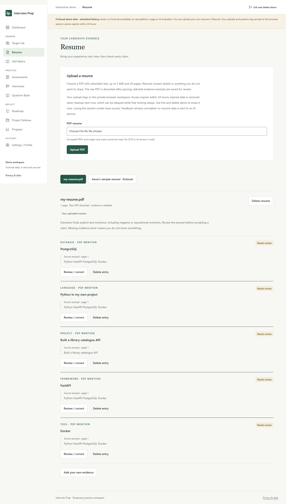
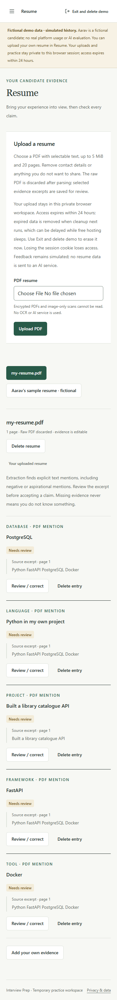
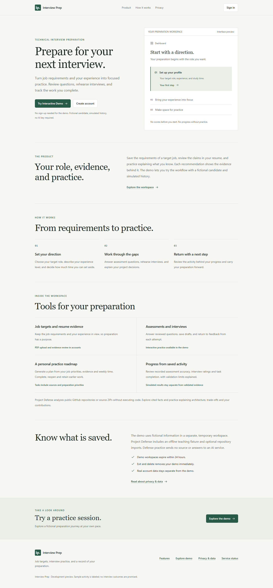
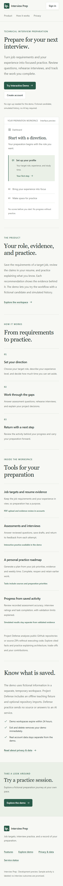
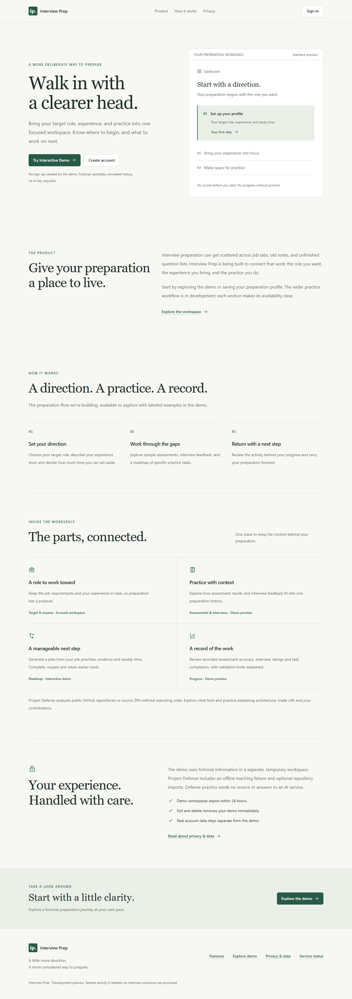
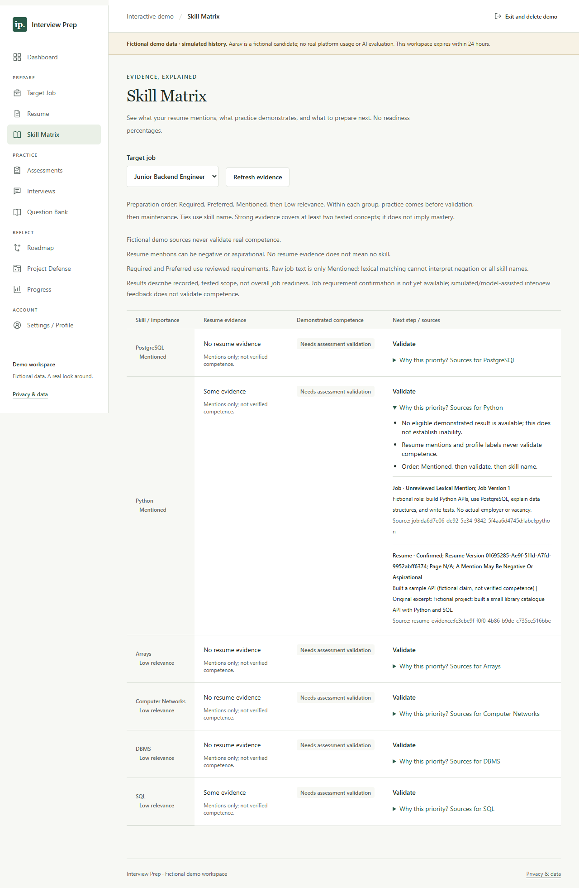
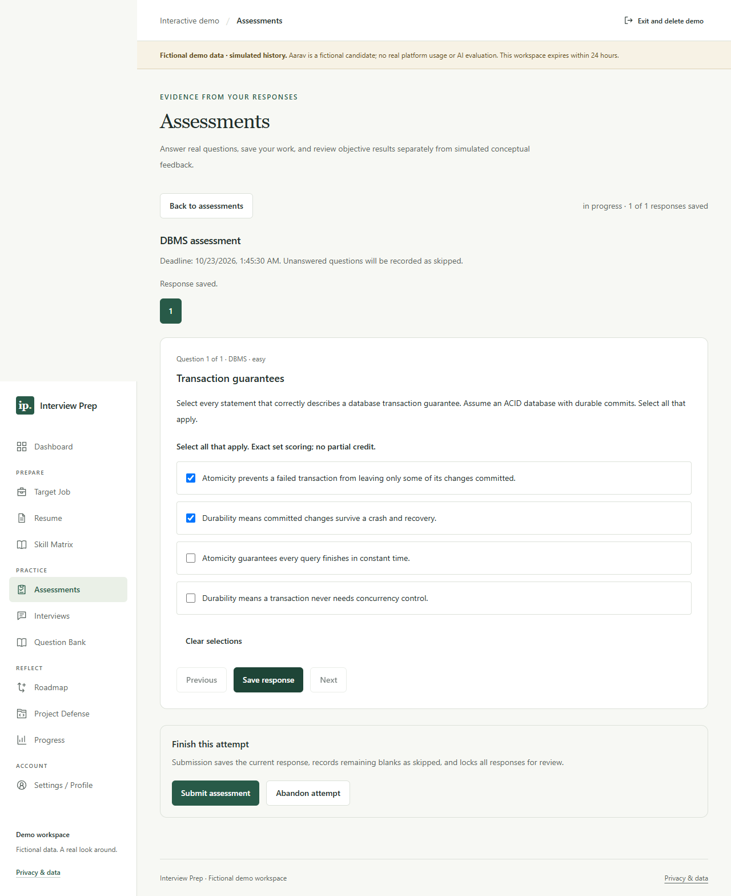
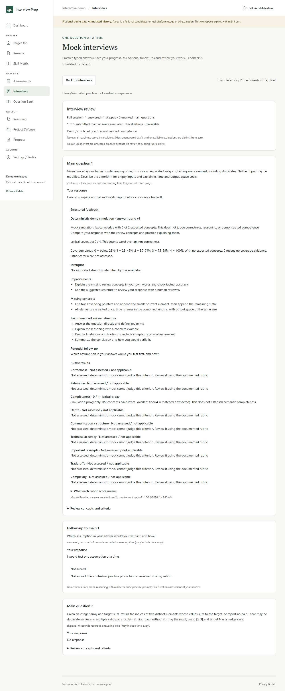
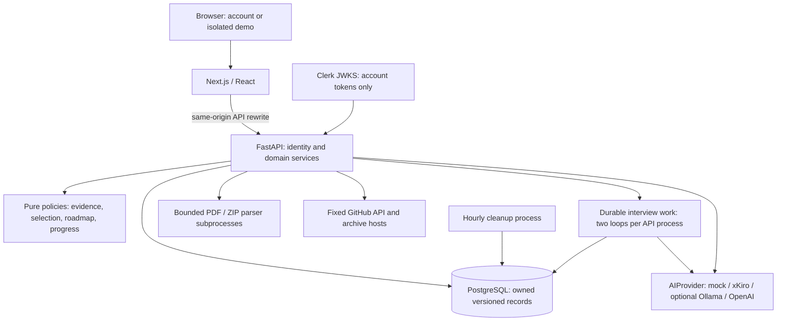

# Interview Prep

An interview preparation workspace that connects candidate context, saved practice
and explainable next steps. Built with Next.js, FastAPI and PostgreSQL, with an
isolated recruiter demo that runs without AI credentials.

The engineering focus is traceable evidence: a resume mention, an objectively
graded answer, simulated feedback and a model judgment have different meanings.
The application preserves those distinctions through its database, algorithms,
API and UI. It does not predict hiring outcomes or calculate a readiness score.

**[Open the hosted demo](https://interview-prep-ai-icyshimakaze.vercel.app)**, then
choose **Upload your resume** or **Try Interactive Demo**. Personal PDF uploads
use a private temporary workspace alongside the fictional example; feedback is
labelled mock. No login or AI key is needed. Free hosting may take time to wake.
You can also [run locally](#run-locally) at <http://localhost:3000>.
See the [deployment record and verification limits](docs/DEPLOYMENT.md).

The hosted profile currently enables the recruiter demo. Production Clerk sign-in
and xKiro account workflows remain disabled pending an owned domain/DNS setup and
the account privacy/security release work. See the
[resume release report](docs/RESUME_UPLOAD_RELEASE.md) for current checks and exact
remaining actions.

Release `cf08aa4` is live on both hosts after green CI. The hosted browser journey
passed personal PDF upload/correction/reload, interview pause/follow-up/completion,
assessments, Project Defense and planning. Visitor isolation and deletion were
verified, with a read-only follow-up after an operator DNS failure. Startup
handling waits for sleeping hosting and reports safe timeout recovery. See
[current status](PROJECT_STATUS.md) for exact test results and limits.

[Recruiter walkthrough](#recruiter-walkthrough) ·
[Architecture](docs/ARCHITECTURE.md) ·
[Interview notes](docs/INTERVIEW_NOTES.md) ·
[Test coverage](docs/TESTING.md) ·
[Current status](PROJECT_STATUS.md)

## Problem and motivation

Preparation often lives in disconnected notes: a resume lists technologies, a
question bank supplies prompts, and a checklist records activity. None alone
shows which claims have been tested, why a topic deserves attention or whether
the candidate can explain a project's decisions.

This project brings those records into one owned workspace. It exists to explore
how to build an inspectable preparation workflow: preserve source context, save
answers before optional evaluation, explain scheduling decisions and let someone
practice defending real source code without executing it.

## Screenshots

Screenshots are captured from the running application with fictional demo data
and synthetic test resumes;
they are product views, not evidence of real users or hiring outcomes.

<details>
<summary>Hosted personal PDF upload — desktop and mobile, 24 October 2026</summary>





</details>

<details>
<summary>Hosted landing page — desktop and mobile, 24 October 2026</summary>





</details>

<details>
<summary>Landing page</summary>



</details>

<details>
<summary>Skill Matrix: source explanations and separate evidence states</summary>



</details>

<details>
<summary>Assessment: persisted objective response</summary>



</details>

<details>
<summary>Interview review: labelled mock feedback and unscored follow-up</summary>



</details>

[Capture provenance and reproduction](docs/screenshots/README.md). The resume
captures show the current `cf08aa4` hosted release. Landing captures show the
earlier `c5ca23e` hosted version; the four other product captures are from the
successful 22 October 2026 local browser run.

## What is implemented

| Area                   | Behavior                                                                                                                                                                                                      |
| ---------------------- | ------------------------------------------------------------------------------------------------------------------------------------------------------------------------------------------------------------- |
| Candidate context      | Account profile and target-job CRUD, versioned job descriptions, bounded PDF resume ingestion and editable source-backed evidence. Temporary workspaces support personal PDFs alongside the fictional sample. |
| Skill Matrix           | Separates job importance, resume mentions and eligible demonstrated results; explains Practice / Validate / Maintain priorities and source eligibility.                                                       |
| Question Bank          | Search, category/topic/type/difficulty/role filters, bookmarks, attempt history and attempt-first concept review.                                                                                             |
| Assessments            | Frozen question/option allocations, saved drafts, deterministic objective scoring, optional written-answer feedback and saved review.                                                                         |
| Interviews             | Seven interview types; typed answers, adaptive main-question selection, bounded follow-ups, pause/resume, durable evaluation and partial final review.                                                        |
| Project Defense        | Public GitHub or ZIP snapshot analysis, file/line citations and saved, unscored explanation practice; includes an explicitly illustrative offline project.                                                    |
| Roadmap and progress   | Deterministic weekly recommendations, preserved plan versions/completions and analytics derived from persisted work with sample-size/provenance limits.                                                       |
| Account/demo isolation | Clerk account integration and separate expiring demo principals; server ownership checks and database constraints protect private records.                                                                    |

## Recruiter walkthrough

No account, AI key or model download is needed. Use fictional answers and data.

1. Open the landing page and select **Try Interactive Demo**. The dashboard names
   the fictional candidate and labels sample activity as simulation.
2. View **Target Job** and **Resume**, then open **Skill Matrix** and select the
   sample target. Expand a source explanation. Resume mentions remain distinct
   from validated performance; demo records never establish competence.
3. In **Question Bank**, change filters, bookmark a question and submit a response
   before reviewing its concepts.
4. Create a small **Assessment**. Objective answers are graded locally; written
   feedback is labelled mock lexical coverage. Save/reload to inspect persistence.
5. Start an **Interview** from the available inventory. Submit an answer, inspect
   feedback, pause/resume and complete or end with partial results. Follow-ups are
   practice prompts and remain unscored.
6. In **Project Defense**, choose **Load illustrative demo project**. Inspect
   observed versus inferred facts and citations; start a defense and save an
   explanation. This is the real parser over an authored fixture, not a fallback
   for a failed GitHub import.
7. Generate a **Roadmap**, complete a task and inspect preserved history and
   **Progress**. A short demo history can correctly show tables or an explanation
   instead of a trend chart.
8. Choose **Exit and delete demo** when finished. Access expires within 24 hours;
   cleanup removes expired records while the service is running. On Render Free,
   physical deletion waits for a wakeup when asleep. Creation is limited to two new
   workspaces per direct network identifier per hour; reuse the current session.

The live site supports **Upload your resume** without sign-in, using a
private temporary browser workspace. Review or correct the extracted evidence,
then use **Exit and delete demo** to erase it. Access expires within 24 hours;
physical cleanup can wait while free hosting sleeps. No resume data goes to AI
in this mode. PDF limits are 5 MiB and 20 pages; the raw PDF is discarded.

Editable account profile/targets and durable account access require
[Clerk setup](docs/AUTHENTICATION.md). Interactive live Clerk flows have not been
established by the mock demo/browser suite.

## Architecture

The backend is a modular monolith with pure policy functions, domain services,
explicit persistence and external adapters. Next.js renders the product and
workspace UI and forwards same-origin `/api/v1/*` requests to FastAPI. Authorization
and scoring remain on the server. OpenAPI generates the TypeScript transport types.



See [current architecture and request lifecycles](docs/ARCHITECTURE.md),
[data model](docs/DATA_MODEL.md) and the original
[V2 design proposal](docs/V2_ARCHITECTURE.md). The proposal contains historical
intent; the current architecture guide describes implemented behavior.

## Explainable adaptive selection

`adaptive-v1` chooses questions using selected-job relevance, eligible performance,
topic coverage, difficulty and exposure history. A new skill starts with an easy
diagnostic. Two eligible successes on distinct concepts raise its target one
level; two eligible failures lower it. Missing evidence is unknown, not failure.

Selection respects exact caller filters, spaces recent questions/concepts, redirects
after two consecutive allocations in one topic and explores a least-covered topic
every fourth allocation. Ties are reproducible from a saved seed. Each choice
records score components and reasons; these are editorial scheduling points,
not probabilities. Small inventories can force disclosed repetition.

Assessments freeze a batch at start. Interviews reuse the selector for each main
turn from a frozen starting context plus new exposures; current-session AI grades
do not change difficulty. Simulation and model judgments never validate skill
evidence. See [the complete algorithm](docs/ADAPTIVE_ALGORITHM.md) and
[evidence eligibility rules](docs/SKILL_EVIDENCE_ENGINE.md).

## Project Defense Mode

The analyzer downloads a public GitHub commit archive from fixed hosts or reads a
bounded ZIP upload. It never runs `git clone`, extracts members to disk, installs
dependencies or executes submitted code. Static inspection emits cited facts and
clearly marked inferences; deterministic templates generate explanation questions.

Practice records preserve drafts, submitted/skipped answers and revisions. Account
users can explicitly request separate AI feedback on a saved Defense answer;
practice transitions and static scanning remain local. No authorship detector or
code-quality score is implemented.
Path/symlink/expansion checks and worker limits reduce risk; subprocess isolation
is not a complete OS security sandbox. [Design and limits](docs/PROJECT_DEFENSE.md).

## AI providers and the zero-key demo

Backend variables: `XKIRO_API_KEY`, fixed `XKIRO_BASE_URL`,
`XKIRO_MODEL_SMART`, `XKIRO_MODEL_MULTIMODAL`, `XKIRO_MODEL_ROUTES` and
`XKIRO_ALLOW_PAID_MODELS`. The complete safe defaults are in `.env.example`;
configure your real key only in ignored backend environment configuration.

The default `MockAIProvider` makes no network/model calls. Its lexical concept
overlap is labelled simulation and cannot establish competence. Account operators
can select **xKiro as the primary real provider** using its OpenAI-compatible Chat
Completions API. Optional Ollama and OpenAI remain available. The default reasoning
model is `qwen/qwen3.8-max:free`; the bounded image adapter uses
`qwen/qwen3.8-omni-flash:free`. Non-free xKiro IDs require explicit model
configuration and `XKIRO_ALLOW_PAID_MODELS=true`; no paid fallback exists.
Objective grading, PDF evidence extraction, job mention matching, skill ordering,
selection, Project Defense practice and roadmap/progress rules remain local.

The shared protocol has six typed operations. Evaluation and contextual follow-ups
serve assessments/interviews. Account users can opt into a retained resume-evidence
review and saved Project Defense answer feedback, with provider disclosure and
sharing consent first. Raw PDFs are discarded; upload alone sends nothing to AI.
Completed reviews are saved for reuse, invalidated on evidence edits and removed
with their source or after 30 days plus cleanup. Additional opt-in reviews analyze
saved job descriptions, suggest activities from evidence-based roadmap reasons,
and generate project practice questions from static facts. These suggestions do
not alter confirmed requirements, scheduled plans or saved defense sessions.
Inline image review remains an internal typed capability.
Output passes schema and domain validation before persistence, with server-assigned
provider/model/prompt/rubric provenance. Errors preserve saved answers; there is
no silent remote-to-mock fallback. The recruiter demo always selects mock.

[Provider architecture, data sharing and deadlines](docs/AI_ARCHITECTURE.md) ·
[Evaluation rubric and score meanings](docs/EVALUATION_RUBRIC.md)

For secure setup, add `XKIRO_API_KEY` privately to the **backend process environment**
or existing ignored **`backend/.env`**, set `AI_PROVIDER=xkiro` and
`PUBLIC_DEMO_ONLY=false`, migrate to head and restart the backend. The native loader
reads absolute root `.env`, then `backend/.env`; process variables override both.
Legacy model variable names remain accepted. Never paste your key into Codex chat,
commit it or put it in a frontend variable. See [the xKiro guide](docs/XKIRO.md)
for exact model routing, per-user budgets, third-party data sharing and mocked tests.
Keep the public production recruiter demo on `AI_PROVIDER=mock` with no key.

## Tech stack and repository structure

| Layer                      | Technologies                                                                           |
| -------------------------- | -------------------------------------------------------------------------------------- |
| Web                        | Next.js 16 App Router, React 19, strict TypeScript, Tailwind CSS 4, Clerk integration  |
| API                        | Python 3.12, FastAPI, Pydantic, HTTPX                                                  |
| Persistence                | PostgreSQL 18, async SQLAlchemy, asyncpg, Alembic                                      |
| Document/source inspection | pypdf, Python AST and bounded JSON/TOML/text analysis                                  |
| Quality                    | pytest, Ruff, strict mypy, Vitest, Testing Library, Playwright, axe, ESLint, Prettier  |
| Packaging                  | pnpm/uv frozen locks, standalone Next.js, non-root containers, Compose, GitHub Actions |

```text
frontend/src/app/              Public, /app and /demo routes
frontend/src/components/       Shared UI and workspace feature views
frontend/src/lib/api/          API clients and generated OpenAPI types
frontend/tests/                Component tests and browser journeys
backend/src/interview_prep/
  modules/                    Domain policies, services, routes and models
  ai/                         Provider protocol, schemas, validation and transports
  core/                       Configuration, errors, request limits and quotas
  db/                         Session and explicit model registry
backend/alembic/               Versioned migrations and database guards
backend/tests/                 Unit, PostgreSQL, migration and security tests
content/                      Reviewed catalogues and preserved legacy provenance
scripts/                      Setup, contracts, smoke and isolated verification
docs/                         Design, operations, security and interview material
.github/                      CI, dependency updates and contribution templates
```

The retired root `app.py` is outside the V2 runtime. Original Streamlit source and
draft content are preserved with provenance; legacy classifier/slider behavior is
not presented as validated prediction. [Migration history](docs/LEGACY_MIGRATION.md).

## Database design

The current SQLAlchemy registry contains **52 application tables** across identity,
candidate context, skills/content, assessments, interviews, projects, roadmaps,
progress and security budgets. This count excludes Alembic's version table and
describes schema structure, not usage.

Private aggregates reference an account or expiring demo principal. Composite
foreign keys protect parent/child ownership; guards freeze published content,
submitted answers and historical identities. Versioned source/question records
and frozen allocations preserve what was actually assessed. Bounded JSON stores
selection context and structured evaluation/snapshot metadata alongside relational
identity, answer, rubric and citation records. Principal deletion cascades private
data; referenced history can block individual source deletion. A full account
erasure/export UI is not implemented. [Integrity and migration details](docs/DATA_MODEL.md).

## API overview

Development Swagger UI is available at <http://localhost:8000/docs>. The committed
[OpenAPI contract](backend/openapi.json) and generated TypeScript are checked for
drift. Production disables Swagger UI.

| Route family                                                                           | Purpose                                                           |
| -------------------------------------------------------------------------------------- | ----------------------------------------------------------------- |
| `/health`, `/api/v1/health/ready`                                                      | Process liveness; database connectivity and exact schema revision |
| `/api/v1/account/session`, `/profile`, `/targets`, `/resumes` under the account prefix | Account bootstrap and candidate context                           |
| `/api/v1/demo/sessions`, `/workspace`, `/session` under the demo prefix                | Isolated demo bootstrap, restore and deletion                     |
| `/api/v1/demo/resume-library` and its owned evidence routes                            | Temporary personal PDF upload, review and deletion                |
| `/{account\|demo}/skill-evidence`, `/questions`, `/assessments` under `/api/v1`        | Evidence, browsing, saved practice and scoring                    |
| `/{account\|demo}/interviews` under `/api/v1`                                          | Revision/idempotency-aware session commands and review            |
| `/{account\|demo}/projects` under `/api/v1`                                            | Imports, snapshots and defense runs                               |
| `/{account\|demo}/roadmap`, `/progress` under `/api/v1`                                | Recommendations, completion and persisted analytics               |

These are route families; the OpenAPI contract lists exact methods and suffixes.
Account requests use verified bearer tokens. Demo mutations use an HttpOnly
capability cookie plus exact Origin and CSRF validation. Clients never select an
owner ID. Errors expose safe codes/messages and request IDs, not driver exceptions.

## Run locally

Prerequisites: Node **24 LTS (24.15+)**, pnpm **12.8.1**, Python **3.12**, uv
**0.12.24** and running Docker with Compose. Node 26 is also supported locally.
Ensure `python`, `node`, `pnpm`, `uv` and `docker` are on PATH; `python` must resolve
to 3.12. Use the pinned lockfiles; the root legacy `requirements.txt` is not the V2
environment. Run commands from the repository root.

### Docker: complete local stack

```sh
python scripts/init_env.py
pnpm install --frozen-lockfile
uv sync --project backend --frozen
docker compose config --quiet
docker compose up --build -d
docker compose --profile tools run --rm seed-questions python -m interview_prep.modules.questions.seed --apply
uv run --project backend python scripts/smoke_stack.py
```

The initializer preserves existing `.env` files and generates random local
credentials. Compose waits for PostgreSQL, applies migrations, then starts the
API/frontend and cleanup. The explicit seed publishes the reviewed small question
catalogue; normal startup does not publish content. The demo seeds its own
fictional private context on entry. Account workspaces start without candidate data.

Open <http://localhost:3000>. API: <http://localhost:8000>; PostgreSQL: localhost
**5433**. Published ports bind to loopback. `docker compose down` stops the stack
while retaining the database volume; adding `--volumes` deletes it.

### Native hot reload

After initialization and frozen installs above, start only PostgreSQL. If Compose
already occupies the web/API ports, first run
`docker compose stop frontend backend cleanup`.

```sh
docker compose up -d postgres
uv run --project backend alembic -c backend/alembic.ini upgrade head
uv run --project backend python -m interview_prep.modules.questions.seed --apply
```

In one terminal:

```sh
uv run --project backend uvicorn interview_prep.main:create_app --factory --reload --host 127.0.0.1 --port 8000 --no-proxy-headers --no-access-log
```

In another terminal:

```sh
pnpm dev
```

Both workflows use the configured application database. For production frontend
packaging locally, `pnpm build` followed by `pnpm start` runs the standalone server.
See [development and troubleshooting](docs/DEVELOPMENT.md).

## Environment variables

Templates: [root `.env.example`](.env.example),
[optional backend overrides](backend/.env.example) and
[frontend `.env.example`](frontend/.env.example). Never commit real `.env` files.

| Variables                                                                | Purpose / local default                                                                                                                                    |
| ------------------------------------------------------------------------ | ---------------------------------------------------------------------------------------------------------------------------------------------------------- |
| `APP_ENV`                                                                | `development`; production enables secure cookies and rejects HTTP origins/placeholder quota keys.                                                          |
| `POSTGRES_DB`, `POSTGRES_USER`, `POSTGRES_PASSWORD`, `POSTGRES_PORT`     | Compose database configuration; generated local password, port 5433.                                                                                       |
| `DATABASE_URL`                                                           | Native/test connection, `postgresql+asyncpg`; match the database credentials and URL-encode reserved characters. Compose sets its internal URL separately. |
| `DEMO_RATE_LIMIT_KEY`                                                    | Random server secret, at least 32 characters; pseudonymous demo/import/provider budget keys. Keep stable across API replicas.                              |
| `ALLOWED_ORIGINS`                                                        | JSON array of exact frontend origins for API CORS/demo checks.                                                                                             |
| `API_PORT`, `FRONTEND_PORT`                                              | Published Compose ports; changing them requires matching URL/origin updates.                                                                               |
| `BACKEND_INTERNAL_URL`                                                   | Server-side Next.js rewrite destination, default native `http://127.0.0.1:8000`; fixed at build time. Compose builds against `http://backend:8000`.        |
| `FRONTEND_ORIGIN`                                                        | Frontend origin used by authentication configuration; match the browser origin.                                                                            |
| `AUTH_ENABLED`, `AUTH_ISSUER`, `AUTH_AUDIENCE`                           | Account JWT verification; disabled by default, demo still available.                                                                                       |
| `NEXT_PUBLIC_CLERK_PUBLISHABLE_KEY`, `CLERK_SECRET_KEY`                  | Optional account integration. Only the publishable key is public; real keys require the documented Clerk configuration.                                    |
| `AI_PROVIDER`                                                            | `mock` by default; optional account `xkiro` (primary real), `ollama` or `openai`. Demo remains mock.                                                       |
| `OLLAMA_BASE_URL`, `OLLAMA_MODEL`, `OPENAI_API_KEY`, `OPENAI_MODEL`      | Backend-only optional provider settings; blank in zero-key mode.                                                                                           |
| `AI_TIMEOUT_SECONDS`, `AI_MAX_RETRIES`                                   | Total per-call deadline 30 seconds; one additional transport retry by default, subject to safe retry rules.                                                |
| `AI_OWNER_HOURLY_CALLS`, `AI_OWNER_DAILY_CALLS`, `AI_GLOBAL_DAILY_CALLS` | Shared attempted-call ceilings: 60 / 200 / 2000. They are not currency limits.                                                                             |
| `INTERVIEW_WORKER_ENABLED`                                               | `true`; starts two database-backed work loops per API process.                                                                                             |

The native backend reads root `.env`, then `backend/.env`; process variables win. Next.js reads `frontend/.env.local`; copy the
frontend example when overriding its configuration. Optional settings and retry
semantics are in [AI architecture](docs/AI_ARCHITECTURE.md). No private key belongs
in `NEXT_PUBLIC_*`, a URL example, screenshot or build argument.

## Migrations

The required head is **`0012_ai_context_reviews`**. Compose applies it through the
one-shot migration service; native development uses:

```sh
uv run --project backend alembic -c backend/alembic.ini upgrade head
uv run --project backend alembic -c backend/alembic.ini check
```

The API readiness endpoint rejects a mismatched schema. Migration tests cover
fresh upgrades, populated preservation/refusal and empty-database round-trips.
Populated downgrades can be intentionally refused; do not erase data or bypass
guards to roll back code. Prefer compatible forward fixes and tested backups.

## Testing and CI

After frozen installs, environment initialization and a running local PostgreSQL:

```sh
pnpm --filter @interview-prep/frontend exec playwright install chromium
pnpm check
```

If normal services occupy the ports, use
`pnpm check --api-port 18101 --frontend-port 13101`. On Windows an installed browser
can be selected with `$env:E2E_BROWSER_CHANNEL = 'chrome'` in PowerShell. The runner
owns its temporary servers and disposable databases and cleans them up. The local
DB role must be able to create/drop its test databases. It does not truncate the
application database. A custom-port build must be rebuilt for normal native use.

The last full verification on **22 October 2026**, recorded in
[PROJECT_STATUS.md](PROJECT_STATUS.md), passed **521 backend**, **134 frontend**
and **23 Playwright** tests, plus lint, strict types, migrations, contract checks
and production/container builds. These are dated executed test results, not
coverage percentages, speed claims or hosted CI status.

[GitHub Actions](.github/workflows/ci.yml) separates backend, frontend and browser
gates; browser checks consume the production build artifact. Tests force mock AI,
clear inherited integration credentials and block real external HTTP. Protocol
tests use in-memory transports. CI never calls paid AI services. Frozen dependency
updates are reviewed through [Dependabot](.github/dependabot.yml).

[Coverage and failure boundaries](docs/TESTING.md) ·
[Contribution guide](CONTRIBUTING.md) · [Changelog](CHANGELOG.md)

## Security and privacy

Server-side principal checks and composite database ownership constraints protect
reads, mutations and durable work. Input budgets cover JSON, PDF, archive and
outbound responses. ZIP members are never extracted; parser subprocesses have
resource limits and stripped environments. Generated content is rendered as text.
Credentials stay server-side, with safe errors and body-free application logging.

Raw PDFs/ZIPs and full extracted/source text are transient. Resume excerpts and
repository paths, hashes and cited facts are persisted and can contain private
data. Optional remote evaluation sends question/answer/rubric context.
Resume review sends explicitly consented retained evidence to the selected provider.
Third-party and downstream-provider retention policies apply. OpenAI's
`store: false` is not a zero-retention guarantee. Demo expiry/exit erases active
owned records; account history has incomplete self-service erasure/export and
backups/identity-provider records require separate handling.

Read the [ranked security review and release gaps](docs/SECURITY.md),
[resume retention](docs/RESUME_PRIVACY.md) and [security reporting policy](SECURITY.md).
This repository is not a privacy-compliance certification or a fully sandboxed
public upload service.

## Deployment

There is no verified public deployment URL or production rollout in this repo.
Compose is a local topology, not a turnkey production ingress configuration.
The prepared [Vercel/Render/Neon runbook](docs/DEPLOYMENT.md) and
[hosting decision](docs/adr/0001-managed-deployment.md) define one Render Free
backend, Vercel and Neon, with an initial mock-only recruiter profile and an
optional Clerk + xKiro account profile on the same app. The initial demo needs no
AI API key; account inference uses a backend-only key. Cleanup runs while awake,
with physical deletion delayed during free-hosting sleep. No deployment occurred.
Before publishing a recruiter URL:

1. Build the pinned frontend/backend images and set the backend destination at
   frontend build time. The public demo leaves Clerk keys unset; add its public
   key only for a separately reviewed account release. Keep secrets server-side.
2. Use a private PostgreSQL instance, back up/restore-test it, apply the reviewed
   migrations with a separate migration role, and explicitly publish content.
3. Set HTTPS frontend origins consistently in `APP_ENV=production`,
   `ALLOWED_ORIGINS`, `FRONTEND_ORIGIN` and optional Clerk configuration. Establish trusted
   proxy/client-IP handling before exposing the demo creation quota.
4. Provide TLS ingress/body/rate limits, restricted parser execution, cleanup and
   durable-worker operation, monitoring and provider spend caps.
5. Keep account access disabled until account erasure/export, identity lifecycle,
   backup/log retention and real sign-in/deletion have been verified. The public
   demo requires neither Clerk credentials nor an AI provider key.

Then replace the hosted-demo placeholder above with the verified URL. Configuration
details and unresolved release requirements are in
[development](docs/DEVELOPMENT.md) and [security](docs/SECURITY.md).

## Limitations and next improvements

The reviewed catalogue is small; editorial difficulty/weights and evaluation
rubrics are not empirically calibrated. Literal short-answer grading is strict;
mock lexical feedback can reward incorrect keyword overlap. Static repository
signals do not prove runtime behavior, security, authorship or test quality.

Assessments evaluate written answers synchronously, so a slow batch can outlast
the browser wait. Interview evaluation is durable but remote computation/billing
is not exactly once. Parser slots are per process; database quotas do not replace
gateway protection. Live Clerk/provider quality and public deployment still need
environment-specific verification. Sparse histories intentionally do not invent
trends. No speech, video, code execution, trained recommendation model or hiring
prediction is implemented.

Next work: close the documented production/privacy gaps; calibrate and expand
reviewed content; add semantic evaluation fixtures and a requirement-review editor;
move assessment feedback to durable work; measure real workload bottlenecks before
splitting services or introducing a learned policy. These are future improvements,
not current features. [Interview discussion](docs/INTERVIEW_NOTES.md) and
[factual resume bullet options](docs/RESUME_BULLETS.md) explain the implemented work.
