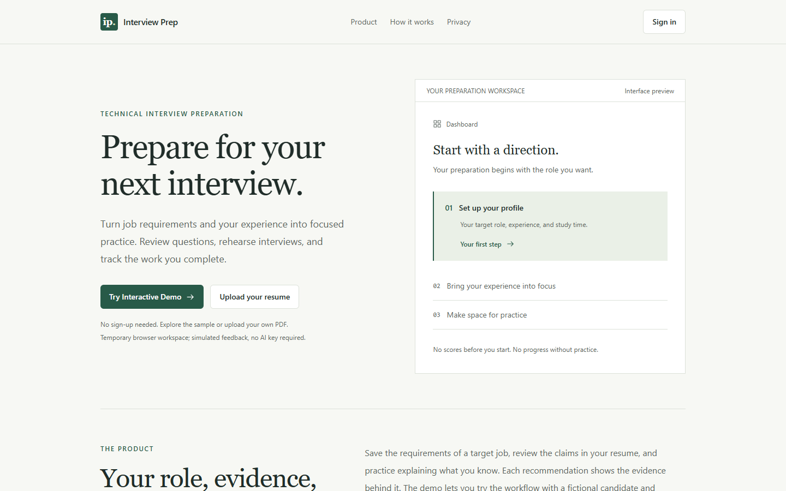
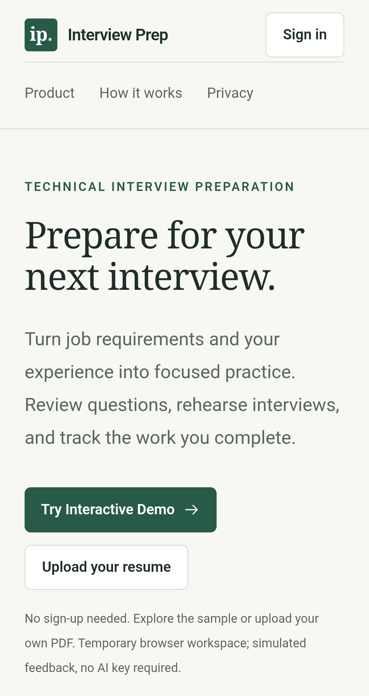
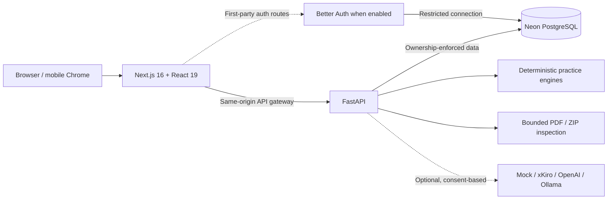

# Interview Prep AI

<div align="center">

**Practice with context. Keep the evidence.**

**An evidence-aware interview preparation workspace for resumes, technical
assessments, mock interviews, project defense, and structured progress.**

[**Explore the live website**](https://interviewprepai.webredirect.org) ·
[**Try the demo**](https://interviewprepai.webredirect.org/demo) ·
[**Architecture**](docs/ARCHITECTURE.md) · [**Local setup**](#run-it-locally)

<br />


<br />



<sub>Actual application, 1440 × 900, rendered from the existing frozen local
build with synthetic settings on 30 October 2026. The embedded workspace
illustration is labelled interface preview. See screenshot provenance
below.</sub>

</div>

---

## Why this exists

Interview preparation is usually fragmented: a resume in one place, question
lists somewhere else, forgotten practice answers, and little context about _why_
the next topic matters.

**Interview Prep AI brings that work into one inspectable workflow.** Instead of
presenting an arbitrary readiness percentage, it distinguishes what a candidate
**claims**, what they have **practiced**, what was **objectively evaluated**,
and what remains **unknown**. Progress and recommendations are linked back to
stored evidence.

> **Live status — 30 October 2026:** The public demo is available with fictional
> data and labelled simulated feedback. The GitHub-only release was rolled back
> after its mandatory callback-correlation acceptance failed; account access
> remains closed. Free hosting may take time to wake.
> [Verified release result](docs/FINAL_LAUNCH_2026_10_30.md).

The [acceptance repair](docs/PRODUCTION_ACCEPTANCE_REPAIR.md) identifies the two
operator-runner defects and their focused regressions. Production stays closed
until a separately approved independent live test passes.

## See the product

Bring in context, inspect its source, then practice and revisit saved work.

<details>
<summary><strong>Explore resume review, the Skill Matrix and interview review</strong></summary>

<table>
<tr>
<td width="58%">

</td>
<td valign="top">
<h3>01 / Bring your own context</h3>
Upload a bounded PDF resume, review extracted evidence, and connect it to an interview target. The
demo supports a temporary, isolated personal workspace; sample and uploaded evidence are clearly
distinguished.
</td>
</tr>
<tr>
<td>

</td>
<td valign="top">
<h3>02 / Understand the gaps</h3>
The Skill Matrix separates job requirements, resume mentions, and demonstrated results. Each
recommendation explains the source and the reason for its priority.
</td>
</tr>
<tr>
<td>

</td>
<td valign="top">
<h3>03 / Practice and keep the evidence</h3>
Answer interview questions, use bounded follow-ups, pause and resume a session, and revisit saved
reviews. Mock lexical feedback is clearly identified as a simulation.
</td>
</tr>
</table>

</details>

<details>
<summary><strong>View the mobile experience</strong></summary>
<br />
<div align="center">


</div>
</details>

Feature screenshots use synthetic resumes and fictional demo records from the
dated local/hosted runs listed in
[capture provenance](docs/screenshots/README.md). The new mobile homepage is a
physical Android capture of the current closed site. No provider consent screen,
real candidate record or token is shown.

## What's inside

| Workspace                | What it does                                                                                                      |
| :----------------------- | :---------------------------------------------------------------------------------------------------------------- |
| **Resume & target role** | Bounded PDF ingestion, editable evidence, target-job context, versioned records.                                  |
| **Skill Matrix**         | Explains the distinction between job importance, resume mentions, and eligible practice evidence.                 |
| **Question Bank**        | Topic, role, category and difficulty filters; bookmarks, answer history and concept review.                       |
| **Assessments**          | Frozen question allocation, saved drafts, deterministic objective grading and review.                             |
| **Mock interviews**      | Multiple interview formats, adaptive selection, bounded follow-ups, pause/resume and durable history.             |
| **Project Defense**      | Static analysis of a public GitHub archive or bounded ZIP, file/line citations and unscored explanation practice. |
| **Roadmap & progress**   | Evidence-linked next steps, versioned plans, task completion and clearly scoped analytics.                        |
| **Public demo**          | Isolated, expiring workspace with fictional data and no account or AI API key required.                           |

### A walkthrough for reviewers

1. Open **[Interview Prep AI](https://interviewprepai.webredirect.org)** and
   choose **Try Interactive Demo**.
2. Explore the fictional candidate's target job, resume and Skill Matrix. Expand
   the source explanations.
3. Filter questions and save an attempt. Create an assessment and inspect the
   objective results.
4. Start an interview, submit answers, pause/resume, and review the labelled
   mock feedback.
5. Open Project Defense, load the illustrative project, and inspect source
   citations.
6. Generate a roadmap and inspect the persisted practice history.
7. Use **Exit and delete demo** when finished.

**Important:** The demo's AI feedback is simulated, and neither its metrics nor
its sample content indicate real-world interview performance.

## System architecture



**Deployment:** Vercel (web), Render (API), and Neon (PostgreSQL). The live site
currently uses the closed/demo profile. In the Better Auth account profile, the
frontend issues RS256 API tokens with a 60-second lifetime; FastAPI verifies
their signature, issuer, audience and active session before resolving the owner.
Demo cookies resolve separate expiring principals. Google/GitHub support and
Clerk compatibility remain in code; neither public OAuth provider is currently
active. Interview workers use PostgreSQL leases and fencing to preserve saved
work. [Current release result](docs/FINAL_LAUNCH_2026_10_30.md).

[Architecture](docs/ARCHITECTURE.md) · [Data model](docs/DATA_MODEL.md) ·
[Authentication](docs/AUTHENTICATION.md) · [Security policy](SECURITY.md)

## Engineering choices

- **Explainability over a fake score.** Recommendation reasons and evidence
  provenance are stored and inspectable; the application does not forecast
  hiring outcomes.
- **Determinism where it matters.** Objective grading, question allocation
  rules, roadmap reasons and demo feedback are reproducible and explicitly
  bounded.
- **Isolated data.** Demo and account workflows enforce ownership in server
  routes and database relationships; access is not decided by client-supplied
  user IDs.
- **Preserved work.** Interview turns, assessment drafts, project defense
  attempts and plans are persisted rather than kept only in browser state.
- **Safe external inputs.** PDF and ZIP sizes are restricted; repository/project
  analysis is static and does not execute user-submitted source code.
- **AI is optional.** The zero-key demo works without a remote model. Optional
  real-provider paths are separate, disclosed, and never quietly substituted for
  mock results.
- **Operational transparency.** Release reports include failed gates and
  limitations alongside passing tests, rather than presenting unverified
  features as live.

[Adaptive selection specification](docs/ADAPTIVE_ALGORITHM.md) ·
[Evidence rules](docs/SKILL_EVIDENCE_ENGINE.md) ·
[Project Defense design](docs/PROJECT_DEFENSE.md) · [Testing](docs/TESTING.md)

## Run it locally

Requires **Node 24 LTS**, **pnpm 12.8.1**, **Python 3.12**, **uv 0.12.24**, and
Docker with Compose. Use the checked-in pinned lockfiles and run from the
repository root.

```bash
git clone https://github.com/icyshimakaze/interview_prep_AI.git
cd interview_prep_AI
# Until the modern application becomes the default branch:
git switch release/github-only-public-2026-10-30-37bbc9a5

python scripts/init_env.py
pnpm install --frozen-lockfile
uv sync --project backend --frozen

docker compose up --build -d
docker compose --profile tools run --rm seed-questions \
  python -m interview_prep.modules.questions.seed --apply
uv run --project backend python scripts/smoke_stack.py
```

Then open **<http://localhost:3000>**. The backend is available at
**<http://localhost:8000>**. Run `docker compose down` to stop the stack without
deleting the database volume.

**Repository note:** The historic default `main` branch may still contain the
retired Streamlit prototype. Until the modern release becomes the default
branch, switch to the reviewed `release/github-only-public-2026-10-30-37bbc9a5`
branch **before running the V2 setup commands**. This note should be removed
only after the actual default-branch transition is verified.

Never commit `.env`, `.env.local`, provider tokens, database passwords,
consent/callback URLs containing authorization codes, or private candidate
files. See the [development guide](docs/DEVELOPMENT.md) and
[example environment variables](.env.example).

## Repository map

```text
frontend/                    Next.js routes, workspace UI, typed API clients
backend/src/interview_prep/   Domain services, policies, persistence, adapters
backend/alembic/              Versioned schema migrations, including 0013
content/                     Reviewed question content and synthetic fixtures
deploy/                      Hosting profiles and placeholder configuration
scripts/                     Setup, verification, migration and contract tools
docs/                        Architecture, operational records, screenshots
.github/                     CI checks, dependency updates and PR guidance
app.py, questions.json       Preserved Python prototype and legacy content
```

The root `requirements.txt` belongs to the retired prototype. Use
`backend/uv.lock` and `pnpm-lock.yaml` for the modern application. The old
README's detailed technical material is retained as a
[historical reference](docs/archive/README_PRE_PORTFOLIO.md).

## Technology

| Layer              | Stack                                                                     |
| ------------------ | ------------------------------------------------------------------------- |
| **Frontend**       | Next.js App Router, React, TypeScript, Tailwind CSS                       |
| **Authentication** | Better Auth; signed short-lived API tokens and FastAPI session validation |
| **Backend**        | Python, FastAPI, Pydantic, SQLAlchemy, Alembic                            |
| **Database**       | PostgreSQL on Neon                                                        |
| **AI adapters**    | Mock provider by default; optional xKiro, OpenAI and Ollama               |
| **Testing**        | pytest, Ruff, mypy, Vitest, Testing Library, Playwright, ESLint, Prettier |
| **Hosting**        | Vercel, Render, Neon                                                      |

## Testing and security

After the frozen installs, environment initialization and a running local
PostgreSQL instance, use these commands from the repository root:

```sh
pnpm lint
pnpm typecheck
pnpm test
pnpm --filter @interview-prep/frontend exec playwright install chromium
pnpm check
```

`pnpm check` includes backend Ruff/mypy/pytest, migration and contract checks,
frontend checks, a production build and browser journeys against disposable
databases. It requires a local database role able to create its own test
databases. Use `pnpm check --api-port 18101 --frontend-port 13101` if normal
ports are occupied. The harness forces mock AI and clears real-provider
credentials. See the
[coverage boundaries and focused commands](docs/TESTING.md).

The 30 October hosted build reached READY and its deployed source hashes
matched. Its Android preflight passed provider restrictions and anonymous
ownership denial; the independent enrollment gate failed and triggered rollback.
This documentation refresh does not claim a new full application-suite pass or a
successful public signup test.
[Exact checks and limitations](docs/FINAL_LAUNCH_2026_10_30.md).

Ownership checks run on the server for reads, mutations and background work.
PDF/ZIP inputs have size, path and worker limits; project code is inspected
statically. Raw files are transient, while retained excerpts and saved answers
can still contain personal data. AI output is untrusted and passes explicit
schema/domain validation before persistence. Remote account feedback requires
explicit configuration and sharing consent; the public demo stays simulated.
Demo access expires within 24 hours; physical cleanup can wait while free
hosting sleeps. Use **Exit and delete demo** for immediate owned deletion.
[Retention details](docs/RESUME_PRIVACY.md) · [Security reporting](SECURITY.md).

## Troubleshooting and contributing

| Symptom                               | What to check                                                                                             |
| ------------------------------------- | --------------------------------------------------------------------------------------------------------- |
| The hosted app takes time to respond  | Free Render hosting can sleep. Use the site's retry/status UI; avoid repeated demo creation.              |
| Sign-in is unavailable                | This is expected in the current closed/demo profile. Use **Try Interactive Demo**.                        |
| Local readiness returns 503           | Check PostgreSQL, the configured ports and a successful Alembic upgrade to `0013_better_auth`.            |
| The local question catalogue is empty | Run the explicit `seed-questions ... --apply` command above after migrations.                             |
| Demo creation returns 429             | The creation quota is two new workspaces per network identifier/hour. Reuse the existing workspace.       |
| PDF text is missing                   | Use a selectable-text PDF within 5 MiB and 20 pages. Encrypted PDFs and image-only scans are unsupported. |

Read [development troubleshooting](docs/DEVELOPMENT.md) and
[CONTRIBUTING.md](CONTRIBUTING.md) before opening a focused PR. Include the
behavior changed, relevant verification and limitations. Use fictional fixtures,
keep strict types and ownership checks, and preserve existing data. Report
security issues privately as described in [SECURITY.md](SECURITY.md). No
contribution license is implied where none is supplied.

## Documentation

| Start here                                             | Go deeper                                                 |
| ------------------------------------------------------ | --------------------------------------------------------- |
| [Architecture](docs/ARCHITECTURE.md)                   | [Data model](docs/DATA_MODEL.md)                          |
| [Development](docs/DEVELOPMENT.md)                     | [API contract](backend/openapi.json)                      |
| [Authentication](docs/AUTHENTICATION.md)               | [Security](docs/SECURITY.md)                              |
| [Testing](docs/TESTING.md)                             | [Current status and release notes](PROJECT_STATUS.md)     |
| [Contributing](CONTRIBUTING.md)                        | [Change history](CHANGELOG.md)                            |
| [Repository presentation](docs/GITHUB_PRESENTATION.md) | [Current release result](docs/FINAL_LAUNCH_2026_10_30.md) |

## Limitations and responsible use

This is a portfolio and learning project, **not a hiring assessment, employment
guarantee, or performance prediction tool**. Simulated evaluations, generated
guidance, and small-sample analytics require critical judgment. Public free-tier
hosting may sleep, throttle or temporarily fail. Real AI providers require
explicit operator configuration and sharing consent. Email delivery/recovery and
public social registration are currently disabled. The question catalogue and
rubrics are small and are not empirically calibrated; lexical simulation does
not establish answer correctness. Static project facts do not prove runtime
behavior or authorship. Immediate browser force-stop can lose a recently written
session cookie; safe reauthentication preserves server records. There is no
speech/video interview, candidate code execution or hiring prediction. Account
self-service erasure/export remains incomplete; see the security review.

Please do not upload real secrets, private repositories, or sensitive candidate
information to a public issue. Security reports should use the guidance in
[SECURITY.md](SECURITY.md).

---

<div align="center">

**Practice. Review the evidence. Return with a next step.**

[**Open Interview Prep AI**](https://interviewprepai.webredirect.org) ·
[**Read the architecture**](docs/ARCHITECTURE.md) ·
[**Report an issue**](https://github.com/icyshimakaze/interview_prep_AI/issues)

</div>
