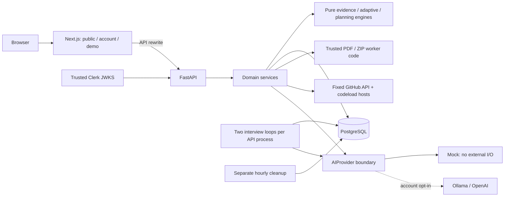

# Implemented architecture

Verified against the V2 source on 22 October 2026. This guide describes the current
application; [V2_ARCHITECTURE.md](V2_ARCHITECTURE.md) records the original design
proposal. [PROJECT_STATUS.md](../PROJECT_STATUS.md) records executed verification
and release limitations. There is no verified production deployment here.

## System boundaries

The application is a modular monolith, with a separate Next.js presentation
process and PostgreSQL persistence. It uses deterministic policy where a model
is unnecessary. Provider-backed feedback is optional and never upgrades a resume
claim or simulated result into validated competence.



The browser sends account bearer credentials or demo cookies to the same frontend
origin. Next forwards API requests; it does not authorize database access. The API
resolves a principal before loading owned context. The database reinforces these
checks with composite references, uniqueness, lifecycle constraints and triggers.

## Modules and responsibilities

Source root: [`backend/src/interview_prep`](../backend/src/interview_prep).

| Module                    | Responsibility                                                                                                      |
| ------------------------- | ------------------------------------------------------------------------------------------------------------------- |
| `main.py`, `core/`, `db/` | App lifecycle, shared HTTP/DB resources, safe errors, pre-parser limits, quota reservations and session scope.      |
| `identity/`, `demo/`      | Verified account identity/bootstrap, expiring demo capabilities, CSRF, isolated fictional seeding and cleanup.      |
| `context/`, `resumes/`    | Versioned target jobs, profiles, local PDF extraction, reviewed/corrected evidence and source deletion.             |
| `skills/`                 | Owner-scoped adapters and pure evidence-state/priority calculation.                                                 |
| `questions/`              | Reviewed immutable content, exact filters, publication, protected answer material, bookmarks and practice.          |
| `adaptive/`               | Pure bounded selection and history/context loading; frozen explanations.                                            |
| `assessments/`            | Allocation, drafts, objective grading, synchronous optional feedback and paid-result receipts.                      |
| `interviews/`             | Session commands, selection context, revisions/receipts, durable leased work and review.                            |
| `projects/`               | Bounded archive acquisition/static inspection, citations, deterministic prompts and separate unscored defense runs. |
| `roadmaps/`, `progress/`  | Deterministic recommendations/scheduling, preserved completions and provenance-aware aggregates.                    |
| `ai/`                     | Typed provider protocol, mock, remote transport, prompts, rubric, schema/domain validation and provenance.          |

Each domain keeps schemas, routes, persistence and business logic distinct. Pure
engines perform no database/network access. Frontend feature views under
[`components/workspace`](../frontend/src/components/workspace) use typed API
clients; shared account/demo workspace context selects the correct endpoint family.
React renders untrusted feedback as text. There is no arbitrary model HTML renderer.

## Important request lifecycles

### Evidence to practice

1. An account saves target context or submits a PDF. The server validates ownership,
   MIME/filename/size and invokes a bounded trusted parser subprocess for PDFs.
2. Local extraction produces cited mentions. The user can reject/correct claims;
   confirmation still does not demonstrate a skill.
3. The skill service reads the latest eligible sources and passes facts to
   `skills/engine.py`. Latest concept/channel results determine evidence state;
   a current weakness takes precedence over success elsewhere.
4. Assessment start applies exact filters, calls `adaptive/engine.py` and freezes
   allocations, option order, context and the selection trace under a principal lock.
5. Drafts are saved separately. Objective submission compares answer sets or
   literal keys on the server; written feedback goes through the selected provider.
6. Roadmaps and progress read persisted facts. They do not ask AI to invent a
   candidate rating, task completion or trend.

### Interview submission and recovery

```mermaid
sequenceDiagram
    participant UI as Browser
    participant API as Interview commands
    participant DB as PostgreSQL
    participant Worker as Interview runner
    participant AI as Selected provider
    UI->>API: submit answer + revision + command key
    API->>DB: lock owner/session; save answer and pending work
    DB-->>API: commit
    API-->>UI: receipt + current session
    Worker->>DB: claim pending work with lease token
    DB-->>Worker: committed dispatch
    Worker->>AI: bounded evaluation outside DB transaction
    AI-->>Worker: untrusted structured output or safe error
    Worker->>Worker: validate schema, domain and provenance
    Worker->>DB: fenced result/failure; update session revision
    UI->>API: reload/poll saved session and review
```

Two loops run per API process by default. PostgreSQL `SKIP LOCKED` claims and
lease-token fencing coordinate work; provider calls do not hold transactions open.
Expired/interrupted jobs are recovered with bounded rules. This is durable work,
not a separate queue service and not exactly-once remote computation. Main-question
selection uses frozen starting evidence plus turn exposures; model feedback in
the current interview does not raise difficulty. Follow-ups are bounded and unscored.

Command UUIDs identify retries; the same key with conflicting input fails. Revisions
reject stale writes. The UI permits at most two worker-only rebases when turn and
candidate answer state still agree, preserving cross-tab conflicts.
[State-machine contract](MOCK_INTERVIEW_STATE_MACHINE.md) ·
[Implemented operations](MOCK_INTERVIEWS.md).

### Project import and defense

GitHub imports resolve a public default-branch commit from fixed hosts; ZIP imports
use bounded raw bodies. Neither path executes Git or project code. A stripped-env,
isolated-Python subprocess reads members in memory, validates paths/expansion and
emits bounded static facts. Parent validation precedes atomic snapshot persistence.
The database retains file metadata/hashes and cited facts, not full sources/ZIPs.
Template-generated questions stay private drafts outside reviewed bank inventory.
Defense runs have separate revision-aware answer state and no evaluation score.

## Data model and consistency

There are **52 application tables**, verified from `Base.metadata` at revision
`0010_security_budgets`; Alembic's version table is additional. This is a structural
count, not an activity metric.

| Aggregate         | Main records and invariants                                                                                                                                         |
| ----------------- | ------------------------------------------------------------------------------------------------------------------------------------------------------------------- |
| Principal/context | `principals`, demo credentials, `candidate_profiles`, interests, `job_targets`/versions, resumes/versions/evidence. Private parents and children share an owner.    |
| Content           | Skills/aliases and question identities/versions, options, keys, concepts, criteria and taxonomy. Reviewed published versions are immutable.                         |
| Assessment        | Assessments, frozen questions/presented options, attempts and responses. An answer must belong to both the same attempt and allocation.                             |
| Interview         | Sessions, turns, answers, versioned evaluations/dimensions, frozen candidate pool, command receipts and durable work. Submitted answers survive evaluation failure. |
| Project           | Repositories, analyses, files, facts, generated question citations, defense runs and answers. Citations reference the same snapshot and bounded file lines.         |
| Planning          | Roadmaps/items and append-only progress events. Regeneration preserves prior versions and completions.                                                              |
| Abuse/retry       | Pseudonymous `operation_quotas` and owned `assessment_evaluation_receipts`. Reservations commit independently of grading rollback.                                  |

SQLAlchemy queries bind values. Fixed SQL in reviewed migrations/guards and advisory
locks is not user-authored SQL. Constraints complement service checks; UUIDs alone
are not authorization. Deferred historical references can block individual source
deletion. Principal erasure cascades its private graph, but there is no full account
self-service erasure/export endpoint. [Data model/recovery](DATA_MODEL.md).

## Provider boundary and trust

Only answer evaluation and interview follow-up generation currently dispatch
through optional remote providers. Six interface operations are tested, but resume
upload, job matching, Project Defense and personalized roadmaps use local pipelines.

Documents/answers are serialized untrusted data, separate from fixed instructions.
The provider receives no shell, database or tool authority. Schema validation checks
types/bounds; domain validation checks concepts, exact spans, profile criteria,
aggregate consistency and provenance. Schema-valid prose can still be wrong or
influenced by injection; feedback needs review. Simulation/model-assisted evidence
does not enter validated skill performance. [AI details](AI_ARCHITECTURE.md).

## Operations and release limits

Compose runs PostgreSQL, a one-shot migration, API, frontend and hourly cleanup;
catalogue publication is an explicit tools command. API liveness does not query
PostgreSQL; readiness requires connectivity and the exact application revision.
Next.js API destinations are fixed at build time. Both runtime images use non-root
users; local published ports bind to loopback. There is no deployment automation.

Shared database quotas cover expensive imports/provider attempts across replicas;
parser/assessment semaphores are per process. AI attempt budgets reserve possible
transport retries, not exact currency. Result receipts reduce repeat assessment
charges but cannot guarantee exactly-once billing after ambiguous network failure.
No general distributed ingress limiter, restricted OS parser sandbox, production
backup policy or complete identity erasure lifecycle is included.

To scale, first measure DB queries, worker backlog, parser utilization and provider
latency without logging candidate text. Likely steps are separate restricted parser
execution, a separately operated worker tier, durable assessment feedback, reviewed
indexes/pagination and gateway limits. These are future designs, not throughput
claims or deployed components. [Security/release gaps](SECURITY.md) ·
[Testing boundaries](TESTING.md).
