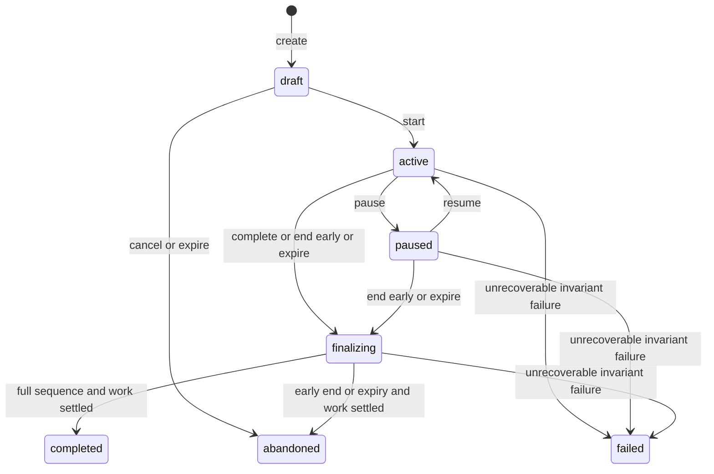

# Mock-interview state machine

Status: **approved design, implemented in the following phase**. This document
records the design reviewed on 2026-10-19; its proposal language describes that
review point. See [the implementation guide](MOCK_INTERVIEWS.md) and
[current verification](../PROJECT_STATUS.md) for delivered behavior and limits.

The interview is a durable owned session with one answerable question at a time.
Submitting an answer commits it before evaluation begins. Evaluation and optional
follow-up generation cannot prevent saving, moving on, ending early or reviewing
the saved work. Mock remains the default and recruiter demos always use mock.

## 1. Existing system and implications

| Existing component                                                                                                | Verified behavior                                                                                                                                                                                                              | Design implication                                                                                                                                                               |
| ----------------------------------------------------------------------------------------------------------------- | ------------------------------------------------------------------------------------------------------------------------------------------------------------------------------------------------------------------------------ | -------------------------------------------------------------------------------------------------------------------------------------------------------------------------------- |
| [Interview models](../backend/src/interview_prep/modules/interviews/models.py)                                    | Session, question, answer, versioned evaluation and evaluation-dimension tables already exist. Session states include draft/active/paused/finalizing/completed/abandoned/failed. Main count is limited to 1–10.                | Extend these aggregates; do not create a competing session model. These tables alone are not an implemented workflow.                                                            |
| [Database guards](../backend/alembic/relational_guards.sql)                                                       | Submitted/skipped answers are immutable. Completed/not-evaluable evaluations require new versions. Interview allocations currently require a published question version.                                                       | Preserve immutability; add a guarded private follow-up source rather than publishing generated text into the catalogue. Use a new migration, never edit frozen migration SQL.    |
| [Assessment service](../backend/src/interview_prep/modules/assessments/service.py)                                | Principal/attempt locks, revisions, start-key replay and frozen allocations exist. Whole-assessment submission evaluates sequentially in its transaction.                                                                      | Reuse ownership/revision conventions, but do not reuse whole-assessment submission for interviews. Long provider calls must run outside interview transactions.                  |
| [Adaptive service](../backend/src/interview_prep/modules/adaptive/service.py) and [policy](ADAPTIVE_ALGORITHM.md) | Pure selection policy supports one question; its database adapter currently takes assessment configuration and assessment-compatible types. Exposures include allocated interview questions.                                   | Add an interview adapter and frozen session inputs; retain the existing pure policy and explainable trace. Do not route design/behavioral questions through the assessment pool. |
| [AI architecture](AI_ARCHITECTURE.md)                                                                             | Six typed operations, bounded/validated outputs, simulation/model provenance, deadlines and safe failures. Answer evaluation returns one 0–4 score, not rubric-dimension scores. Mock follow-ups are generic authored prompts. | Use `evaluate_answer` and `generate_followup`; never fabricate dimension scores or claim the existing mock understands context. Define the contextual demo presentation below.   |
| [Identity dependencies](../backend/src/interview_prep/modules/identity/dependencies.py)                           | Account bearer verification and demo cookie capabilities are separate; demo mutations require origin/CSRF checks.                                                                                                              | Every new route and worker uses the same principal boundary. No owner/provider/credential field comes from the browser.                                                          |
| [Skill performance](../backend/src/interview_prep/modules/skills/performance.py)                                  | Interview competence requires completed deterministic evaluations with complete authored dimensions.                                                                                                                           | These simulated/model-assisted interviews do not establish competence or raise adaptive difficulty.                                                                              |
| [Demo seeding](../backend/src/interview_prep/modules/demo/seeding.py) and frontend history                        | A fictional completed interview is displayed through dashboard/history readers. There is no interview command router or durable AI job queue.                                                                                  | Preserve this fixture and historical views; new sessions need explicit new-version handling and durable work storage.                                                            |

The repository manifests contain 29 questions, of which **23** are written,
design or behavioral: 12 Data Structures, three Algorithms, two Computer Networks,
and one each OOP, Backend, Frontend, System Design, Behavioral and DBMS. This is
source-manifest inventory, not proof that a running database has published them.
Runtime options must count actual visible, eligible published versions.

## 2. Configuration and question selection

Proposed configuration contract, rejecting unknown fields:

| Field            | Values and behavior                                                                                                                                                                            |
| ---------------- | ---------------------------------------------------------------------------------------------------------------------------------------------------------------------------------------------- |
| `target_id`      | Owned target UUID or null for general practice. Resolve the latest owned job version at start; snapshot title, role relevance and normalized skill importance. Foreign/missing IDs return 404. |
| `interview_type` | `technical_fundamentals`, `backend`, `frontend`, `full_stack`, `system_design`, `behavioral`, `mixed`.                                                                                         |
| `difficulty`     | `auto`, `easy`, `medium`, `hard`; default `auto`. Explicit levels are exact filters, not promises that the selector can override.                                                              |
| `question_count` | Strict integer 1–10, counting main questions only. UI proposes five only when inventory supports five, otherwise a supported count with a coverage notice.                                     |

All interview types use typed answers. Eligible source types are `written`,
`design` and `behavioral`, with complete authored concepts/rubrics that fit the
existing provider contract (including at most 12 concepts/rubric descriptions,
each at most 1,000 characters). Never silently truncate grading context. MCQ and
literal short-answer assessment formats remain separate. A versioned mapping
`interview-types-v1` uses explicit catalogue categories, never fuzzy keyword or AI
classification of a job title:

| Interview type         | Eligible main-question categories                                                 | Required coverage                                                                                                                                                                 |
| ---------------------- | --------------------------------------------------------------------------------- | --------------------------------------------------------------------------------------------------------------------------------------------------------------------------------- |
| Technical Fundamentals | Data Structures, Algorithms, OOP, DBMS, SQL, Operating Systems, Computer Networks | Topic diversity from the eligible pool. Current SQL/Operating Systems entries are not typed-interview formats and therefore do not qualify.                                       |
| Backend                | Backend, DBMS, SQL, Computer Networks, OOP                                        | At least one Backend-category question.                                                                                                                                           |
| Frontend               | Frontend                                                                          | Frontend questions only; expand reviewed content before offering a broader count.                                                                                                 |
| Full Stack             | Union of Backend categories and Frontend                                          | At least one Backend and one Frontend question; count must be at least two.                                                                                                       |
| System Design          | System Design                                                                     | Design questions only.                                                                                                                                                            |
| Behavioral             | Behavioral                                                                        | Behavioral questions only.                                                                                                                                                        |
| Mixed                  | Union of the above                                                                | At least two category families when count is at least two; one-question Mixed uses the whole eligible pool. Families: fundamentals, Backend, Frontend, System Design, Behavioral. |

Mapping guards also enforce `design` for System Design and `behavioral` for
Behavioral. Required coverage is checked after difficulty/visibility filters.
For example, the current Frontend pool supports only one medium question; System
Design only one hard question; Behavioral only one easy question. An unavailable
configuration returns `409 interview_pool`, with no partially started session.
Never silently lower the count, change the type/level, generate substitute main
questions or repeat a main question within a session. Options show unavailable
choices and explain how to change the configuration.

At start, freeze the configuration, target version, bounded candidate-version
list and minimal adaptive inputs (skill importance/need, eligible performance,
recent exposure identities and total count). Store no resume/JD text in this
snapshot. Use existing selector limits; oversize context returns a safe conflict,
not a truncated success claim. Snapshot retention equals session retention.

Allocate just the first main question. Later `advance(main)` calls select from
the frozen pool minus already allocated stable question IDs. Update only this
session's exposure history and coverage counters. Enforce required coverage by
restricting candidates when the remaining slots must satisfy an unmet category;
then call the pure selector with `count=1`. Persist the trace and seed derived
from session ID and main ordinal. Check feasibility before each selection.
Unexposed frozen candidates do not count as exposures and never reach the browser.

`auto` uses the existing cold start/history policy, including nearest available
level notices. At easy cold start, a hard-only System Design pool must explicitly
disclose the coverage mismatch. Explicit difficulty always remains exact.
The selector's deterministic tie-breaking, cooldown and diversity rules remain
testable. Simulated or model-assisted answers in this session do not supply
eligible performance; V1 therefore does not change difficulty based on those
scores. Follow-ups never enter competence or main-question exposure counts.

Ordinary catalogue retirement after start does not invalidate frozen allocations
or frozen candidates; retain their immutable versions. The new interview access
guard must allow that specific frozen reference, while creation cannot select a
retired version. A separately defined urgent content withdrawal can fail closed;
do not quietly replace missing context or content during resume.

## 3. State model and invariants

Use three related state machines instead of treating provider progress as the
session state. API views derive the interactive phase from persisted records.

**Session status:** existing `draft`, `active`, `paused`, `finalizing`, `completed`,
`abandoned`, `failed`. `failed` is reserved for an unrecoverable invariant/context
failure, not an AI outage. `completed` means the configured main questions were
resolved; `abandoned` means ended early, expired or cancelled before start.
Both support review. Add `ended_at` and `end_reason`; preserve the existing rule
that `completed_at` exists if and only if status is `completed`.

**Interactive phase:** `answering`, `between_questions`, `followup_pending`, or
null outside active/paused. A ready follow-up is an offer in `between_questions`;
the server does not automatically expose it. `current_turn_id` identifies the
last exposed turn, even after it is resolved. Pause preserves that cursor and
phase; workers may finish work but cannot expose another turn.

**Turn:** existing `awaiting_answer`, `submitted`, `evaluating`, `evaluated`,
`evaluation_failed`, `skipped`, plus proposed `unanswered` for a draft closed by
end/expiry. Only `awaiting_answer` is editable. Submitted/evaluating/evaluated/
evaluation_failed/skipped are all resolved for navigation. Provider progress
never makes a submitted answer editable again.

Hard invariants:

- At most one `awaiting_answer` turn per session; no future main prompts in the
  session response. Only `start`, `resume` where appropriate, or explicit
  `advance` may begin answering; GET never advances or changes timers.
- Main ordinals are contiguous 1–N; delivery sequence includes follow-ups and is
  unique. No repeated stable main-question ID or duplicate follow-up parent.
- One answer per turn. A final answer's text, submission key and time never change.
- The current turn must resolve before another is exposed. Evaluation may overlap
  answering the next turn. No command permits returning to edit an earlier answer.
- Session configuration/context/provider policy freeze at start. Server-generated
  provenance cannot be supplied by a model or request body.
- No new turns after finalizing. Completed/abandoned/failed sessions are read-only.
  Final reviews are deterministic projections of frozen rows, not new AI summaries.

### Session and interaction transitions

| Command/event                | Guard                                                                                   | Atomic outcome                                                                                                                |
| ---------------------------- | --------------------------------------------------------------------------------------- | ----------------------------------------------------------------------------------------------------------------------------- |
| Create                       | Valid owned config; limits                                                              | New draft, revision 1; no question exposure or provider call.                                                                 |
| Change config                | Draft + matching revision                                                               | Replace draft config; no frozen content yet.                                                                                  |
| Start                        | Draft; configuration still feasible                                                     | Freeze context/provider/pool, allocate main 1 and empty answer, set active/answering and timers.                              |
| Save answer                  | Active/answering + current turn/revision                                                | Update draft only, preserve exact text, increment revisions. Empty draft is null.                                             |
| Submit answer                | Active/answering + nonblank text                                                        | Atomically save supplied text, mark submitted, stop answer timer and queue evaluation; enter between_questions immediately.   |
| Skip                         | Active/answering                                                                        | Preserve any supplied draft as skipped, stop timer; no evaluation, no follow-up eligibility; enter between_questions.         |
| Request follow-up            | Active/between_questions on a submitted main; limits allow                              | Reserve one decision slot and enqueue generation; phase followup_pending. Parent evaluation need not be finished.             |
| Follow-up generation settles | Matching owned job; session active/paused                                               | Store validated ready offer, or safe unavailable decision; phase becomes between_questions. No turn exposure or timer starts. |
| Advance to follow-up         | Active/between_questions; ready offer for current main                                  | Consume offer, allocate child, set current cursor/answering and start child timer.                                            |
| Advance to main              | Active, current resolved; more main questions remain                                    | Close/cancel any pending or ready offer, allocate next main once, enter answering. No evaluation wait.                        |
| Pause                        | Active, any phase                                                                       | Optionally save current draft in the same command, stop active timers, set paused. Work already queued may finish.            |
| Resume                       | Paused, unexpired                                                                       | Restore cursor/derived phase and answering timer if applicable; do not select or regenerate a question.                       |
| Complete                     | Active/between_questions or followup_pending; all N mains resolved; no unanswered child | Cancel unused offer, set finalizing/full, stop session; do not create another turn.                                           |
| End early                    | Active/paused, any phase                                                                | Apply explicit draft disposition below, cancel unused follow-up work, set finalizing/early; no further main allocation.       |
| Cancel draft                 | Draft                                                                                   | Abandoned/cancelled_before_start immediately; empty review, no completion event.                                              |
| Expire                       | Draft/active/paused at deadline                                                         | Cancel draft or close live session as finalizing/expired, retain unsubmitted draft as unanswered; no implicit submission.     |
| Finalizer                    | Finalizing; all evaluations terminal or finalization deadline reached                   | Freeze final review and terminal status; emit completion event only for full completion.                                      |

All other commands return a documented conflict without partial state changes.
An answer marked `evaluation_failed` still counts as answered. Skipping counts
toward main-question completion but never as a zero-score evaluation. A session
with all questions skipped may complete and must say “No answers evaluated.”

### Answer and work transitions

`awaiting_answer -> submitted -> evaluating -> evaluated | evaluation_failed`.
Skip gives `awaiting_answer -> skipped`; early close retaining a draft gives
`awaiting_answer -> unanswered`. Corresponding answer rows remain `draft` for
unanswered, `skipped` for skipped, or `submitted` for evaluated work. Session guards
prevent modifying a retained draft after close. Empty skip rows have null text.

An evaluation uses existing `pending -> running -> completed | failed |
not_evaluable`. V1 authored main questions are evaluable; contextual follow-up
answers use `not_evaluable` with a disclosed reason, because the provider's
follow-up contract does not supply a reviewed scoring rubric. They still appear
in final review beside their parent. Do not score them against the parent's
question as though it were the same task.

For an answered child, persist a not-evaluable record with null score, kind
`self_review`, evaluator/rubric version `interview-followup-review-v1` and a fixed
explanation that no reviewed scoring rubric exists. Set its turn to `evaluated`
only as a lifecycle marker; the view must say “Not scored,” never “AI evaluated.”
Its generation provenance remains separate on the content record. Do not call
`evaluate_answer` for a child or attribute this local decision to a remote model.

## 4. Timing, interruption and browser behavior

Server UTC timestamps are authoritative. Record session start/end, per-turn
presentation/resolution, accumulated answering milliseconds and an optional
open timing interval. Count answering time only while active/answering; exclude
explicit pauses, between-question decisions and provider waits. The UI interpolates
from returned `server_time`, `answering_ms` and `running_since`. Timing is advisory,
never a correctness signal, hard countdown or automatic submission trigger.

A disconnected browser is not observable reliably. Without an acknowledged pause,
an open answering interval continues until submit/pause/end/expiry, so it may
include time away. State that limitation in review; do not label it exact attention
time. Use injected clocks for tests, never browser-reported durations for storage.
Clamp interval closure at the session deadline and reject negative durations.

Proposed expiry is 24 hours after start, or 24 hours after creation for an unstarted
draft; a demo cannot outlive its existing workspace expiry. Pause does not extend
expiry. A maintenance loop closes expired account sessions. Reads report
`expired: true` and disable actions immediately even before that loop runs; GET
does not perform writes. Mutations after expiry return `409 interview_expired`.
Expired demo authentication still follows the existing unauthorized/erasure policy;
it does not create a permanent review exception.

On reload, GET restores the current turn, last acknowledged draft, phase, saved
timer and evaluation/offer states. An active disconnected session remains active;
a paused one requires Resume. Poll while work is pending, backing off from two to
ten seconds and stopping when hidden/offline or terminal. Polling never changes
question selection. No WebSocket is required for V1.

Debounced autosave shows Saving/Saved/Unsaved. Serialize saves per tab. Submit,
skip, pause and end commands include the latest text as specified below, so the
browser need not rely on a preceding autosave succeeding. Wait for acknowledgement
before replacing the current question. On a timeout retain local text and retry
the exact command key/body, then reload. On a stale revision preserve local text
in memory, reload and ask the user to reconcile; never silently overwrite another
tab. Do not put private answer text in localStorage, telemetry or URL parameters.
After a reload only server-acknowledged text is recoverable; disclose this limit.

## 5. Contextual follow-ups and limits

Follow-ups are an optional **Ask a follow-up** action after submitting a main
answer, before leaving that main. They never appear after a skip or another
follow-up. Maximum **one request slot per main**, **three slots per session**,
and depth **one**. Thus 1–10 main questions allow at most 13 exposed turns.
A failed/cancelled request consumes its slot; repeating the same idempotency key
replays it rather than consuming another. There is no regenerate-until-satisfied
control. These bounds include reservation, so races cannot exceed the limit.

The generator receives only the frozen parent prompt, submitted answer, authored
concepts/rubric and the actual prompts already exposed in this session. All fit
the existing provider's limits (answer 10,000 characters; recent prompts at most
20). No full resume, JD, unrelated transcript, target URL or secret is sent.
Generation does not require a score and cannot alter the parent evaluation.

For mock, retain the provider's clearly simulated authored probe and present it
with the exact parent question and a bounded literal answer excerpt (up to 200
characters) as context. Persist those context references with the offer. This
makes the practice task contextual without claiming semantic diagnosis; it does
not pretend the generic mock probe was inferred from the answer. Optional models
can produce an answer-specific probe, labelled model-assisted and unverified.

Validate generated JSON, nonblank question/rationale, exact-repeat avoidance,
and the session's parent/budget constraints before persisting. Repeat comparison
also normalizes whitespace/case at the interview layer. Semantic paraphrase
deduplication is not promised. No raw model output becomes HTML or executable code.
The rationale is held for review to avoid exposing assessment hints during play.

While generation is pending, **Continue without follow-up**, Pause and End remain
available. Advancing to a main, completing or ending closes the decision and
cancels its job/offer. Late results cannot insert a turn or move the cursor.
If unavailable, show that reason and allow Next/Complete; never silently substitute
mock for a configured model. Demo stays mock from the start.

## 6. Proposed HTTP contracts

New route prefixes: `/api/v1/account/interviews` and `/api/v1/demo/interviews`.
Both use the same service contracts, with separate authentication dependencies
and unconditional demo-provider pinning. UUID IDs, UTC ISO timestamps, strict
integers, bounded strings, no extra request fields and `Cache-Control: no-store`.
These routes are proposed; do not add them to generated OpenAPI until implemented.

Every mutation carries a UUID `command_key`; after create it also carries strict
positive `revision`, the last observed session revision. `C` in the table means
those two fields. Draft text is null or at most 10,000 characters; whitespace-only
draft becomes null, while otherwise exact text is preserved. Submit requires a
nonblank string within that bound. No client-supplied score, owner, prompt, time,
provider, selected question version or context snapshot is accepted.

| Method/path (relative to prefix)                      | Request                                                         | Success and effect                                                                                                                                                                                               |
| ----------------------------------------------------- | --------------------------------------------------------------- | ---------------------------------------------------------------------------------------------------------------------------------------------------------------------------------------------------------------- |
| `GET /options`                                        | Optional `target_id` query                                      | 200: all seven type labels, available counts by exact difficulty, coverage constraints, answer/count/follow-up limits, provider disclosure and supported policy version. Counts are advisory; start revalidates. |
| `POST /`                                              | `command_key`, `configuration`                                  | 201: draft command response. Enforce at most five unfinished and 100 retained sessions per owner, matching assessment-scale safeguards.                                                                          |
| `GET /`                                               | `offset` 0–100000, `limit` 1–50 (default 10), optional `status` | 200: owned summaries, total and pagination. Stable created_at/id descending order; no answer text.                                                                                                               |
| `GET /{session_id}`                                   | None                                                            | 200: SessionView, including current prompt/draft only.                                                                                                                                                           |
| `PUT /{session_id}/configuration`                     | `C`, `configuration`                                            | 200: draft-only replacement.                                                                                                                                                                                     |
| `POST /{session_id}/start`                            | `C`                                                             | 200: first main turn.                                                                                                                                                                                            |
| `PUT /{session_id}/turns/{turn_id}/draft`             | `C`, `answer_text`                                              | 200: saved current draft.                                                                                                                                                                                        |
| `POST /{session_id}/turns/{turn_id}/submit`           | `C`, `answer_text`                                              | 202 for main: saved and queued. 200 for child: saved with an unscored review record.                                                                                                                             |
| `POST /{session_id}/turns/{turn_id}/skip`             | `C`, `answer_text` (nullable)                                   | 200: current draft retained as skipped, no evaluation.                                                                                                                                                           |
| `POST /{session_id}/turns/{turn_id}/followup`         | `C`                                                             | 202: generation slot reserved for this submitted main.                                                                                                                                                           |
| `POST /{session_id}/advance`                          | `C`, `from_turn_id`, `next_kind: main                           | followup`                                                                                                                                                                                                        | 200: exactly one newly exposed turn. `main` cancels any offer; `followup` requires a ready offer. |
| `POST /{session_id}/pause`                            | `C`, `draft: null                                               | {turn_id, answer_text}`                                                                                                                                                                                          | 200: pause; supplied draft must be the current editable turn.                                     |
| `POST /{session_id}/resume`                           | `C`                                                             | 200: resume saved position. Already active requires reload/replay, not a second timer start.                                                                                                                     |
| `POST /{session_id}/complete`                         | `C`                                                             | 202: finalizing after N main questions resolved; cancels unconsumed offer.                                                                                                                                       |
| `POST /{session_id}/end`                              | `C`, `current_answer_action`, `draft`                           | 202 for active/paused finalization; 200 for draft cancellation. See disposition below.                                                                                                                           |
| `POST /{session_id}/turns/{turn_id}/evaluation/retry` | `C`, `evaluation_id`                                            | 202: one explicitly requested retry of a failed main evaluation before finalizing, with a new evaluation version.                                                                                                |
| `GET /{session_id}/review`                            | None                                                            | 200 for finalizing/terminal sessions; 409 while draft/active/paused. Finalizing review is labelled provisional with pending counts.                                                                              |

`end.current_answer_action` is `keep_draft`, `submit`, `skip` or `none`.
For an editable current turn, require one of the first three and an explicit
`draft: {turn_id, answer_text}`; `submit` requires nonblank text. `keep_draft`
marks it unanswered and never evaluates it. For a resolved turn or unstarted
session require `none` and `draft: null`. This makes ending early atomic with
the user's choice about unsent text. No silent answer submission or discarded
draft. End from paused can submit the supplied answer without restarting timing.

### Response shapes

`CommandResponse = {receipt, session}`. `receipt` contains `command_key`,
`operation`, `session_id`, `applied_revision` and relevant created `turn_id`/
`evaluation_id` (nullable). `session` is a fresh authorized SessionView. On replay
the receipt/status are stable; the session may have advanced since the command.
Clients must not assume replay returns the old session snapshot.

SessionView contains:

- Identity/status: `id`, `revision`, `contract_version`, `status`, `phase`,
  `configuration`, `expired`, `started_at`, `deadline_at`, `ended_at`,
  `completed_at`, `end_reason`, `server_time`.
- Frozen disclosure: target title/version reference, provider name/configured
  model/result kind, selection/prompt policy versions, simulation/sharing notice.
  No credentials, raw source documents or internal scoring inputs.
- Progress: main requested/presented/resolved counts, answered/skipped counts,
  follow-up reserved/presented counts and remaining slots. Main progress never
  counts a child as another configured main question.
- Current turn or null: ID, main ordinal, sequence, parent ID, kind, prompt,
  category, effective difficulty, turn status, saved answer text/status/revision,
  advisory timing and evaluation status only. A child also includes its parent
  context excerpt. No rubrics, matched concepts, scores or evaluation feedback yet.
- Follow-up decision: `none | pending | ready | unavailable | declined | consumed`,
  associated parent, safe error code if any. A ready prompt is withheld until
  explicit `advance(followup)` exposes it.
- `allowed_actions`, safe coverage/selection notices and evaluation pending/failed
  counts. UI controls follow these capabilities but server validates every command.

ReviewView contains the configuration/provider disclosure, end reason,
`review_status: provisional | final`, `evaluation_coverage: complete | partial |
none`, progress totals and actual per-turn timing. It lists exposed turns in
delivery order with parent links, text/status, final answers or explicitly
unsubmitted drafts, authored review concepts/rubric, latest evaluation status,
safe failure reason, feedback and provenance. Generated children have no invented
rubric. Never expose unasked frozen candidate prompts or unrelated owned records.

For main scores use the provider's actual **0–4** scale and label simulation versus
model assistance. Do not turn it into a readiness percentage, correctness claim,
dimension breakdown, pass/fail or hiring recommendation. Show evaluated coverage
and per-answer feedback instead of an aggregate score. Pending, failed, skipped,
unasked and not-evaluable are distinct; none is coerced into score zero.

Evaluation coverage concerns submitted main answers only: `none` if none has a
completed evaluation, `complete` if every submitted main has one and at least one
was submitted, otherwise `partial`. Report the denominator and failed/pending
counts explicitly. Children remain separate unscored practice. Report unasked
main slots as configured count minus presented mains without inventing turn rows.

### Errors

Retain `{code, message, request_id}` with safe fixed messages. New codes need
explicit registration in the existing error mapper; raising a string detail
alone currently falls back to generic conflict handling.

| HTTP/code                                                            | Recovery                                                                                                   |
| -------------------------------------------------------------------- | ---------------------------------------------------------------------------------------------------------- |
| 401/403                                                              | Reauthenticate or restore valid demo capability; preserve in-memory text, never downgrade account to demo. |
| 404 `not_found`                                                      | Missing or foreign session/turn/target, indistinguishable. No mutation receipt lookup leaks existence.     |
| 409 `interview_revision`                                             | GET current state, reconcile local draft, then create a new command.                                       |
| 409 `command_conflict`                                               | Key reused with different method/path/body; do not execute.                                                |
| 409 `interview_state`, `interview_turn`, `interview_expired`         | Reload and follow allowed actions; never reopen a final answer.                                            |
| 409 `interview_pool`, `interview_limit`, `interview_context_limit`   | Correct configuration/limits before starting. No partial allocation.                                       |
| 409 `followup_limit`, `followup_not_ready`, `evaluation_retry_limit` | Continue without another generation or wait/reload as applicable.                                          |
| 422 `validation_error`                                               | Correct bounded/enum/blank-answer fields without losing local input.                                       |
| 503 `unavailable`                                                    | Database/transaction availability failure: retry the identical key and body.                               |

Provider outages are recorded on durable work and surfaced in the view, not a
503 implying a submitted answer was lost. A DB timeout may have an uncertain
commit outcome; idempotent replay resolves that uncertainty.

## 7. Database changes and transactions

Propose a new versioned migration after `0006_real_assessments`, with its own
frozen guard SQL. Exact revision name is chosen at implementation time.

| Existing/new table                         | Proposed changes                                                                                                                                                                                                                                                                                                   |
| ------------------------------------------ | ------------------------------------------------------------------------------------------------------------------------------------------------------------------------------------------------------------------------------------------------------------------------------------------------------------------ |
| `interview_sessions`                       | Add contract/config version, bounded frozen configuration/selection context, immutable provider descriptor (no secret), current-turn same-owner/session FK, `ended_at`, `end_reason`, finalization deadline and timing fields. Existing `main_question_limit` remains the main count.                              |
| `interview_candidates` (new, owned)        | Freeze eligible stable question/version IDs under the session, with historical version FKs and unique session/stable-question constraint. At most 1,000 rows. These are eligible candidates, not exposed turns; retaining them prevents deleting an unasked frozen source.                                         |
| `interview_questions`                      | Add source discriminator, nullable bank version, nullable private follow-up-content reference, main ordinal, stable bank question ID for uniqueness, presentation/resolution/timing, bounded selection trace and follow-up decision state. Exactly one content source. Add `unanswered` to the named status CHECK. |
| `interview_followup_contents` (new, owned) | Session/parent IDs, immutable validated prompt/rationale, context excerpt, actual provider/model/prompt version/kind, input digest. One per parent; cascade with session. No global publication or false authored provenance.                                                                                      |
| `interview_answers`                        | Keep one answer, revision and immutable final submission. API limits new text to 10,000 while preserving older rows allowed up to 30,000. No destructive narrowing migration.                                                                                                                                      |
| `answer_evaluations`                       | Reuse versions/status/provenance. Add nullable `score_scale_max` and bounded validated result payload for matched concepts. New aggregate results use score 0–4 and scale 4; leave old ambiguous 0–100 storage untouched and explicitly legacy. No fabricated EvaluationDimension rows.                            |
| `interview_commands` (new, owned)          | Unique owner/command key, operation/resource IDs, canonical request digest, applied revision and small result receipt/status. Do not duplicate answer text here. Create key may initially have no session FK, then binds within the same transaction.                                                              |
| `interview_work` (new, owned)              | Session, turn/answer/evaluation references as appropriate; operation, dedupe key, state, lease token/expiry, dispatch marker, deadline, attempts and safe error code. Store references/digests, not copied documents/answers.                                                                                      |
| `progress_events`                          | Reuse existing interview_completed event and unique owner/deduplication key; no event type expansion needed. Early end/expiry is not full completion.                                                                                                                                                              |

Use owner-composite foreign keys, and same-session/parent constraints where needed.
The main turn's persisted follow-up decision is authoritative even when a work row
has already succeeded: ready-to-declined closes an unused offer without rewriting
the successful work result. A worker may commit an offer only while that parent's
decision is still pending. Child main ordinal inherits its parent's ordinal;
the unique main-ordinal index applies to main turns only.
Add a partial unique index for one awaiting-answer turn per session, unique main
ordinal and stable main question per session, unique follow-up parent, unique
evaluation version, and unique job operation/input version. Under session locks,
check total main/follow-up limits; deferred constraint guards also verify depth one,
parent is a submitted main, cursor membership and no allocation after close.

Replace only the interview binding of `relational_question_access`: bank sources
must belong to the frozen authorized pool, generated sources must reference same-
owner/session immutable follow-up content and cannot carry a project reference.
Preserve assessment/bookmark/project behavior. Existing project-defense sessions
remain legacy/read-only for this API; do not weaken project citation guards.
Ensure status updates on a frozen bank turn still work after ordinary retirement.

For source snapshots/JSON use explicit schema versions and byte bounds: config
8 KiB, per-turn trace 16 KiB, provider result 16 KiB, frozen selection context
2 MiB maximum. If bounded current selector inputs exceed that snapshot budget,
reject start with a safe context-limit error. The snapshot excludes prompts; those
remain referenced immutable versions. Only selected/generated prompt content is
returned to clients.

### Mutation transaction pattern

1. Authenticate and verify requested owner/session/turn relationships. Acquire
   locks in consistent order: principal, session, turn/answer, work/receipt.
2. Look up the owner's command key. Matching operation/path/canonical body digest
   returns the original receipt before stale-revision checks; mismatch conflicts.
3. For a new command, verify revision, state, current cursor, expiry and limits.
4. Apply all changes, insert any work and receipt, increment session revision once
   per committed command, and commit. Roll back everything on failure.
5. Build the authorized fresh view. A lost HTTP response is safe to replay.

Create uses the principal lock to serialize limits/key allocation. A canonical
digest includes operation, path IDs, explicit nullable fields, exact answer text,
configuration and supplied revision; no lossy normalization of nonblank answers.
Keep receipts for the session's lifetime, erasing with the owner/session. Every
autosave gets a fresh key; retries reuse the same key/body. Row uniqueness remains
the final protection across multiple API instances.

Workers increment session revision when visible work/evaluation/offer state
changes. Consequently an autosave can conflict with a just-completed evaluation;
the client reloads and safely retries its current draft rather than assuming
only other browser tabs change revisions. Worker lease heartbeats alone do not
increment it. This favors correctness over avoiding every benign conflict.

Main submit commits answer + evaluation row + unique work row + receipt together;
child submit commits answer + not-evaluable record + receipt without queued work.
Advance commits offer cancellation/consumption + one allocation + draft answer +
cursor + trace together. End commits draft disposition + work cancellation +
closing state together. Finalization commits terminal timestamps + one completion
event (full sessions only) + frozen review version together. Existing event guard
requires `occurred_at == completed_at`; retain that invariant. Use null event
result kind when no main was evaluated, otherwise the actual simulation/model kind
of completed main evaluations. Unscored children do not change that event kind.

## 8. Evaluation timing and durable recovery

Evaluate **after each submitted main answer**, asynchronously, with feedback
hidden until review. This supports progress without waiting and avoids leaking
rubric hints into follow-ups. Only complete authored rubric/concept inputs enter
the existing `AnswerInput`; no content-based command or tool execution is allowed.
Bind the session to its provider descriptor at start. If the configured provider
or model changes before a job runs, mark it unavailable; never silently use another
provider. Credentials are resolved server-side at execution, not snapshotted.
Construct a per-execution provider with the remaining deadline and the shared
HTTP client; do not mutate the application's shared provider timeout while other
requests are using it.

There is currently no durable AI queue. V1 should add a small database-backed work
loop in the backend lifespan, usable with one local process and no Redis/API key.
Multiple processes claim with short `FOR UPDATE SKIP LOCKED` transactions; a
dedicated process can use the same worker later. Do not rely on an in-memory task
or FastAPI BackgroundTasks as the source of truth. Startup and periodic scans
recover pending work, expiry and finalization even without an open browser.
Use bounded concurrency (initially two work items per process) and oldest-ready
claim order; expired jobs settle without a provider call. Scheduler throughput is
not guaranteed across arbitrary deployment sizes, but deadlines bound waiting.

The worker lifecycle is:

1. Claim pending work in a short transaction with a random lease token. Read and
   validate owner activity, demo expiry, session state, immutable inputs/digest
   and current provider compatibility before dispatch; no network under DB locks.
2. Persist a dispatch marker, commit, then call the provider with its existing
   total timeout and transient-only transport retry policy. Proposed job deadline
   is 120 seconds after enqueue, including queue wait; lease duration 90 seconds
   exceeds the provider's maximum 60-second call deadline. Pass only the lesser
   of remaining job budget and configured provider timeout to execution.
3. Validate output using the provider boundary and interview-specific constraints.
   In a new transaction lock principal/session/turn/work in the standard order,
   verify lease token, owner, unchanged input/version and open work deadline, then
   persist the result and mark work terminal. Reject stale/late/cancelled results.

Work states are `pending`, `running`, `succeeded`, `failed`, `cancelled`. A crashed
claim without a dispatch marker may be reclaimed after lease expiry. If dispatch
was recorded and the result is unknown, fail with `evaluation_interrupted` or
`followup_interrupted`; do not automatically replay a possibly billed request.
A crash between dispatch-marker commit and actual network send is conservatively
treated the same. Exactly-once remote computation is not promised; exactly-once
application of an accepted result is enforced by lease/version/uniqueness guards.

Provider transient retries stay inside its one deadline. The queue does not add
unbounded generation retries. While active/paused, an explicitly requested retry
of a failed main evaluation is allowed once (at most two versions total), using
the same frozen input/provider policy and a new work row. Failed versions remain
in history. The latest version is shown; no duplicated answer or question.
Do not offer retries after finalization starts; final results are immutable.

On complete/end/expiry, finalization waits for accepted evaluations only, not
follow-up offers. Set a fixed 120-second finalization deadline. A worker or
maintenance scan marks outstanding jobs failed when their own or finalization
deadline expires, fencing later results, then finalizes with partial coverage.
Normal completion happens as soon as all evaluations settle. Follow-up answers
are already not-evaluable and cannot delay it. A stopped backend cannot process
anything, but the next startup scan settles overdue work; no browser action or
new AI credential is needed to recover.

An optional provider outage must leave mock/demo sessions fully functional and
allow affected remote sessions to finish with saved answers and unavailable
feedback. It must never label simulated output as real inference.

## 9. Ownership, privacy and retention

- Resolve principals from the existing account/demo dependencies on every request.
  Demo routes reject Authorization headers and require origin/CSRF on every
  mutation. No account fallback to demo and no cross-owner lookup by naked UUID.
- Apply owner and parent/session predicates to reads, command replay, worker
  claims/results, follow-up source resolution, review and history. Workers recheck
  account activity/demo validity before sending data and before committing output.
  Whole-principal erasure fences/cascades pending work; a result cannot recreate it.
  Data already sent to a provider cannot be recalled by deleting a local session.
- Before start, disclose provider and exactly what will leave the server. Only
  question, answer and bounded authored context go to optional providers; target
  relevance selection is local. No credentials or private documents in logs,
  frontend config, public catalogue, URLs or command receipts.
- Authored review fields/AI feedback are hidden until finalizing or terminal review,
  including through dashboard/history joins. Existing question-bank access may
  separately permit reviewing previously attempted content; this is practice,
  not a secure proctored examination. Audit all alternate readers for leakage.
- Store private drafts, final answers, evaluation provenance, offers and selection
  inputs under existing owner retention. Account history has no automatic deletion
  policy today; session expiry ends interaction, not storage. State this in the
  UI/privacy docs. Demo exit/expiry erases its records through the existing cascade.
  Individual interview deletion/export and account-erasure APIs are separate work.
- Treat model prose as untrusted text. Schema/source validation bounds structure,
  not truth or adversarial influence. No outcome, readiness or validated-skill
  claims derive from these simulated/model-assisted grades or advisory timings.

## 10. Compatibility and implementation boundaries

Backfill existing session rows with a `legacy` contract marker, leaving content,
statuses, timestamps, answers, scores and provenance byte-for-byte unchanged where
possible. Never infer a new interview type/configuration from a fictional session.
Legacy sessions remain readable via history/review; new lifecycle commands reject
them with a specific compatibility conflict. New-version invariants apply only
to new-version sessions; existing answer/ownership integrity still applies to all.

Audit and update existing consumers during implementation:

- Dashboard/history feedback must not expose in-progress evaluation hints.
- Skill-performance joins must tolerate nullable bank-version IDs and keep generated
  children and all simulation/model results ineligible. No fake dimension expansion.
- Adaptive exposures and question-history counts must exclude follow-up sources
  **before** counting/limiting; an inner join that drops them after counting would
  incorrectly change cooldown/exploration cadence.
- New interview options need design/behavioral coverage; do not expand assessment
  types or change existing assessment scoring as a side effect.
- Demo seeding remains a labelled fictional example; add new interactive demo
  sessions through the real command path with mock, never invent completed events.

Deploy the additive migration and compatible API/frontend together in a later
authorized phase. Refuse a downgrade that would lose new sessions/work/content;
preserve old rows and use a forward fix or compatible reader for rollback. Test
whole-owner erasure with deferred historical references and new work/content FKs.
No migration file, generated OpenAPI, TypeScript client or deployment is part of
this design phase.

Suggested small implementation modules: schemas/state policy, owned queries,
commands/transactions, interview selection adapter, follow-up policy, evaluation
adapter, work runner and review projection. Keep HTTP, UI, persistence and external
calls separate. Inject clock, selector, provider and job executor for tests.

## 11. Acceptance tests for the implementation phase

| Area                    | Required evidence                                                                                                                                                                                                                                                                 |
| ----------------------- | --------------------------------------------------------------------------------------------------------------------------------------------------------------------------------------------------------------------------------------------------------------------------------- |
| Transition policy       | Every allowed and forbidden session/phase/turn transition; only one answerable turn; skip/submit/end from each phase; full vs early vs expired completion.                                                                                                                        |
| Configuration           | All seven types, target ownership, exact/auto difficulty, count bounds, Full Stack two-side coverage, Mixed diversity, insufficient sparse inventory and unsupported formats.                                                                                                     |
| Selection               | Cold start, eligible-history starting level, deterministic seeds/traces, stable-ID no repeats, cooldown fallback disclosure, frozen target/catalogue inputs and no mock-driven difficulty changes.                                                                                |
| Answers and timing      | Exact saved text, blank submit rejected, nullable draft, 10,000-character boundary, atomic latest-text submission, pause/resume timers, disconnected-time disclosure, injected-clock expiry without sleeps.                                                                       |
| Idempotency/concurrency | Lost create/save/submit/advance/end replies; same key changed body conflicts; double-click Next creates one turn; stale tab cannot overwrite; worker revision conflict; submit-vs-skip and end-vs-submit races.                                                                   |
| Follow-ups              | Parent context, mock disclosure, one per main/three per session/depth one; skip ineligibility; pending-to-next cancellation; ready-to-end cancellation; duplicate text/invalid schema; no late question insertion.                                                                |
| Evaluation/work         | Default mock zero-network success; unavailable optional providers; schema/refusal/timeout failures; durable queue commit; crash before/after dispatch; lease fencing; manual retry bound; no network transaction lock; provider change; finalization deadline and partial review. |
| Ownership               | Account/account, demo/demo and account/demo isolation for all routes and receipts; foreign nested IDs; CSRF; expired/suspended principals; cancellation/deletion during provider call; private generated content never visible in bank.                                           |
| Review/evidence         | No hints through current/dashboard/history routes; main counts separate from children; unavailable/skipped/unasked distinct from zero; exact provenance/scale; no invented rubric dimensions, confidence, readiness or validated skill.                                           |
| Database/migrations     | Constraints bypassing service validation, stable source/version immutability, populated legacy preservation, clean upgrade/drift/roundtrip, unsafe downgrade refusal, deferred reference erasure and completion-event uniqueness.                                                 |
| Browser/demo            | Start each available type, one prompt, type/save/reload/resume/skip/follow-up/end/complete/review, tab conflicts/offline retry, keyboard/focus/mobile, timing announcements without per-second screen-reader noise, no AI key needed.                                             |

Review walkthroughs: a two-main normal session with one child ends completed and
one event; an early end keeps a draft unanswered with no completion event; a dead
provider leaves submitted answers navigable and finalizes partial; a lost submit
response replays one receipt; a cancelled generation cannot displace the next
main; an expired demo cannot retrieve or recreate private interview work.

Next step is implementation of this reviewed design in a separately requested
phase, starting with migration/state-policy tests and owned transactional commands,
then durable work, UI and end-to-end verification. The document does not claim
these acceptance tests have been written or run.
