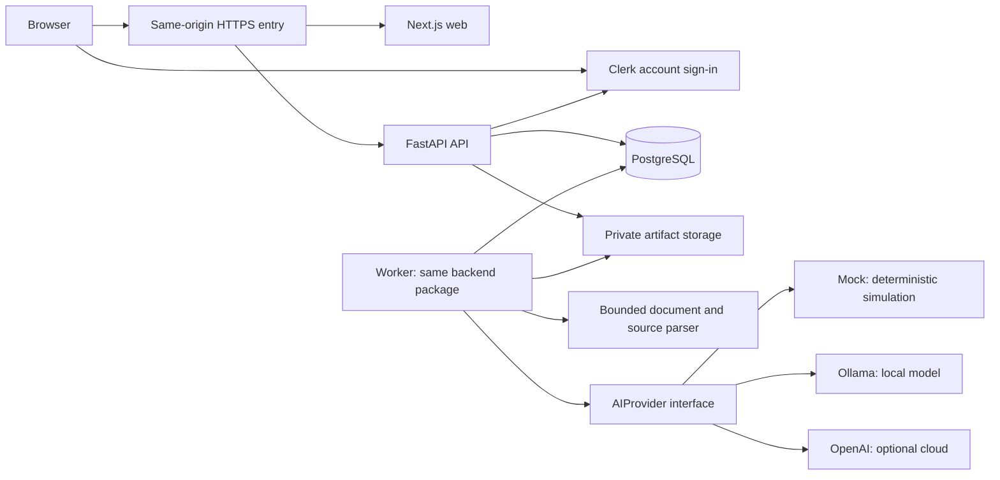
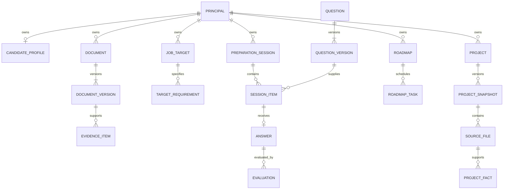
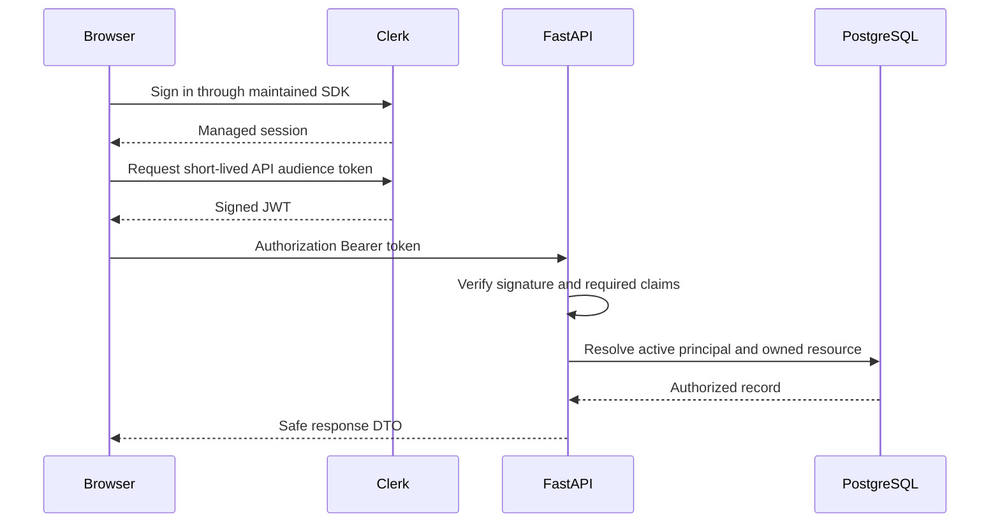
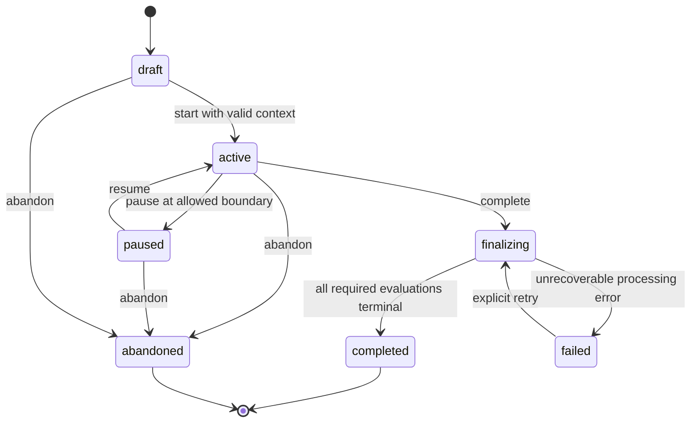
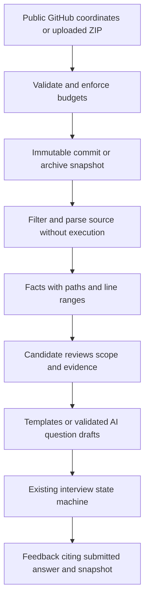

# V2 architecture

Date: 2026-10-09 (Asia/Calcutta). Status: approved design specification; foundation implementation is recorded in [project status](../PROJECT_STATUS.md). Baseline: commit `48fcd90`, reviewed alongside [the audit](CURRENT_STATE_AUDIT.md), [engineering rules](../AGENTS.md), and [planning guidance](../.agent/PLANS.md).

Implementation note: the foundation uses `frontend/`, `backend/`, and root `compose.yaml` in accordance with the subsequent explicit user request, replacing the proposed `apps/web/`, `apps/api/`, and `infra/compose.yaml` paths below. The generated health/demo API types live in the sole frontend package until a second consumer justifies a shared client package. V1 remains unchanged at the root, with deterministic draft exports; major product features, accounts, AI and job processing remain future phases. See [development instructions](DEVELOPMENT.md) for actual commands and configuration.

Build an adaptive interview preparation platform whose recommendations can be explained and whose progress can be traced to actual work. The portfolio should demonstrate sound contracts, authorization, state transitions, failure handling, tests, and deployment discipline. AI is an optional capability behind a defined boundary, not a substitute for those foundations.

## 1. Product boundaries

### Intended experience

A candidate creates a preparation profile, reviews evidence extracted from a resume, confirms the requirements of a target job, completes an assessment, practices recommended questions, runs text-based mock interviews, receives feedback, follows a realistic roadmap, and reviews progress. Project Defense Mode later adds questions grounded in a specific source snapshot of the candidate's project.

| Capability | In scope | Boundary |
| --- | --- | --- |
| Candidate profile | Target role, experience band, timezone, study budget, optional deadline and confidence ratings. | No demographic inference, employer ranking, or hiring decisions. |
| Resume evidence | Extracted claims with source locations, candidate correction and confirmation. | A resume claim is not proof of competence or employment verification. |
| Target job | Pasted job description, normalized skill requirements, user-confirmed priorities. | No general-purpose web scraping or arbitrary URL fetching. |
| Assessment | Curated objective items and rubric-based written responses; recorded attempts. | No code execution or unsupported interview-success probability. |
| Adaptive practice | Explainable selection from an eligible, versioned question pool. | No artificial ML trained on fabricated labels. |
| Mock interview | Durable text turns, bounded follow-ups, optional timer, review after completion. | Voice, video, proctoring, and live coding sandboxes are deferred. |
| Roadmap | Curated tasks scheduled against confirmed gaps and study capacity. | AI cannot invent resources, mark tasks complete, or overwrite a plan silently. |
| Analytics | Coverage, comparable results, completion, and evidence freshness. | No fake user counts, testimonials, outcomes, or readiness guarantees. |
| Project Defense | Public GitHub snapshot or uploaded source ZIP; cited architecture and tradeoff questions. | No private GitHub access, dependency installation, project execution, or ownership certification. |

The first complete learning track targets junior backend/full-stack preparation: HTTP/API design, SQL/data modeling, data structures, and testing/debugging, with Python/TypeScript examples. Add other tracks only when content and rubrics exist. The V1 role dropdown does not establish coverage for ML engineering or data analysis.

### Three operating modes

- **Recruiter demo:** a visitor receives an isolated, expiring workspace with synthetic profile/resume/job/project fixtures. `MockAIProvider` is mandatory. No account, AI key, real upload, external repository fetch, or paid inference is needed. Clearly label simulated feedback and sample history. Zero AI API cost does not mean zero hosting cost.
- **Local development:** Docker Compose, the same isolated demo flow, and real deterministic assessment work without cloud credentials. An optional local Ollama instance enables actual model-backed workflows. Real account integration needs Clerk development configuration.
- **Account mode:** authenticated private workspaces, real documents and job descriptions, durable history, export/deletion, and explicitly selected allowed providers. Public deployment may initially expose only recruiter demo mode until account/security gates pass.

The public demo can accept short practice answers within quotas; tell visitors not to enter sensitive information. Simulation-derived evaluations never enter real performance analytics. Objective questions still use actual deterministic grading, including in the demo, with the workspace clearly identified as a demonstration.

## 2. Architecture

Use a modular monolith: one FastAPI application owns business behavior and one PostgreSQL database owns durable state. Next.js is the web client. A worker runs the same backend package for slow parsing and provider calls; it is not a separately designed domain service. There is no Kafka, Kubernetes, vector database, agent framework, or distributed service choreography.



The Clerk connection from the API is for trusted key discovery and exceptional identity lifecycle operations, not an authentication network call on every request. Browser traffic reaches `/api/v1/*` through the same public origin. The gateway routes those requests directly to FastAPI; Next.js must not become a second implementation of authorization or domain logic.

Use ordinary request/response APIs and job polling first. Slow work returns `202 Accepted` and an owned job ID. Do not keep an HTTP request or database transaction open while a model generates a response. Add streaming only if a measured UX requirement justifies it.

### Durable jobs without a message broker

Create a `jobs` row in the same transaction as the operation it represents. The worker claims due rows using a short `FOR UPDATE SKIP LOCKED` transaction, sets a lease and attempt number, then releases the transaction before external work. PostgreSQL documents this locking option as suitable for queue-like consumers. [PostgreSQL SELECT documentation](https://www.postgresql.org/docs/current/sql-select.html)

Jobs transition `queued -> running -> succeeded | failed | canceled`; expired leases can be retried. Use a unique logical operation key, at most three execution attempts, bounded exponential backoff, and idempotent result publication. A result transaction checks lease ownership, operation version, and whether the principal/resource still exists. Account deletion or cancellation prevents late results from restoring deleted data. Payloads contain owned resource IDs, not copies of documents or credentials.

This is at-least-once execution, not exactly-once provider invocation. A crash after a paid provider call may require another invocation; record invocation attempts and enforce budgets. Reclaim leases, expose terminal errors, and test worker crashes. Start with one worker and bounded concurrency; introducing a broker requires evidence that this design no longer meets demand.

## 3. Monorepo layout

The following is the proposed layout, not files created by this design task:

```text
apps/
  web/
    src/app/                   # App Router routes and route layouts
    src/features/              # Profile, assessment, practice, interviews, roadmap
    src/components/ui/         # Selected shadcn/ui primitives
    src/lib/                   # API transport, auth adapter, formatting
    tests/                     # Component and Playwright tests
    package.json
  api/
    src/interview_prep/
      main.py
      api/                     # Versioned routers and dependencies
      core/                    # Settings, identity, errors, observability
      db/                      # SQLAlchemy models and session handling
      modules/                 # Small feature modules
      ai/                      # Provider contracts, adapters, prompt versions
      worker/                  # Job loop, handlers, isolated parsing entry point
      storage/                 # Local-private and object-store implementations
    alembic/
    tests/
    pyproject.toml
    uv.lock
packages/
  api-client/                  # Generated TypeScript types/client from OpenAPI
content/
  topics/ questions/ resources/ # Reviewed, versioned public curriculum
fixtures/
  demo/                        # Clearly synthetic, non-personal example data
infra/
  compose.yaml                 # Web, API, worker, Postgres; optional Ollama
  docker/                      # Images and gateway configuration
docs/
.agent/plans/
AGENTS.md
PROJECT_STATUS.md
pnpm-workspace.yaml
pnpm-lock.yaml
```

Keep the V1 files in place until an explicitly scoped migration step moves them to `legacy/v1/`. Pin compatible runtime/package versions during bootstrap and commit lockfiles. Use pnpm for the web workspace and uv for Python. Add no workspace orchestration layer until ordinary workspace scripts prove insufficient. Keep `.env` files ignored and uncommitted; document configuration with a sanitized template containing placeholders only.

## 4. Frontend structure

Use Next.js App Router, React, strict TypeScript, Tailwind, and selected shadcn/ui components. Use server components for appropriate page shells and client components for interactive forms, assessment turns, uploads, and job polling. Keep features small; avoid a single dashboard component controlling every workflow.

| Route group | Purpose |
| --- | --- |
| `/` and `/demo` | Honest landing page and entry into an isolated recruiter demo. |
| `/sign-in`, `/sign-up` | Clerk account UI, enabled only when configured. |
| `/app/profile`, `/app/resume`, `/app/targets` | Profile and evidence review; target requirement confirmation. |
| `/app/assessments`, `/app/practice` | Start/resume sessions and review completed attempts. |
| `/app/interviews/[id]` | State-driven interview, saved draft, turn status, completion review. |
| `/app/roadmap`, `/app/progress` | Task plan, evidence-based charts, history and filters. |
| `/app/projects` | Later Project Defense ingestion, evidence review, and interview launch. |
| `/app/settings` | Provider consent, export, source deletion, and account deletion. |

Use generated API types and a small fetch wrapper. Introduce TanStack Query for polling, invalidation, and server-state caching when the first interactive flow needs it. Form drafts stay in feature-local state; the API persists interview drafts and important profile edits. URL parameters hold shareable non-sensitive filters. Do not use browser storage as the source of truth for answers or save private documents/tokens in localStorage.

Show saving/saved/error states and prevent duplicate submit gestures while still relying on backend idempotency. Reconnect by reading the persisted session, not by inventing its state from the page. Never cache personalized server responses publicly; clear query caches when identity or demo workspace changes. Do not put resume content, answers, or provider tokens in URLs.

Provide keyboard navigation, form labels, error summaries, visible focus, accessible status announcements, readable mobile layouts, and tables accompanying charts. Clearly distinguish deterministic grading, model-assisted feedback, self-review, and simulated feedback. Model failure is a recoverable status, not a fabricated successful result. The dashboard leads with the next useful action and evidence coverage, not vanity cards.

## 5. Backend structure

Use FastAPI, Pydantic, fully annotated Python, SQLAlchemy 2-style models, Alembic, and PostgreSQL. Prefer async database/provider I/O; CPU/file parsing runs outside the API process. Establish one SQLAlchemy session per unit of work, explicit transaction boundaries, and one migration history. Do not use ORM auto-create in production.

Feature modules: `profiles`, `evidence`, `targets`, `questions`, `sessions`, `evaluations`, `selection`, `roadmaps`, `analytics`, and later `projects`. Each contains only the schemas, focused services, and queries it needs. Routers validate request contracts and resolve identity; services implement rules; explicit queries require an ownership scope. Avoid generic repository factories and a giant service layer.

Pydantic request models forbid unexpected fields and constrain lengths/enums/ranges. Response models deliberately omit answer keys, internal prompts, storage keys, and secrets. Provider DTOs, ORM models, and public API DTOs are separate contracts. The API is the authority for timestamps, owner IDs, state transitions, and score calculations.

Logging uses request/job correlation IDs, duration, status, and error codes. Do not log request bodies, model prompts, credentials, source text, or answers. Health endpoints distinguish process liveness from database/schema readiness; optional AI unavailability must not take down deterministic practice.

## 6. Database model

Create tables as their implementation phase requires them. This is the target logical model, not a requirement to scaffold every table on day one. UUID primary keys, UTC timestamps, foreign keys, check constraints, and explicit indexes are standard. JSONB is for bounded versioned payloads and rule traces; relationships and identity do not live in opaque JSON.

Implementation update (2026-10-12): the user explicitly requested the full relational foundation ahead of the later workflows. Revision `0002_relational_model` implements the requested model in 36 normalized domain tables, preserving the three existing demo infrastructure tables. `User` maps to `principals`. Resume/job versions, skills/evidence, assessment and interview aggregates, versioned evaluations, bookmarks, roadmaps/progress and cited project snapshots are explicit entities. Assessments and interviews use separate aggregates rather than the conceptual shared `preparation_sessions`/`answers`; this provides stricter typed parent/attempt constraints. Skills cover the current global topic vocabulary; broader track/resource catalogs, selection decisions, jobs, AI runs and privacy operations remain later work. See [the implemented entity mapping and migration policy](DATA_MODEL.md).

| Entity group | Principal fields and relationships |
| --- | --- |
| `principals` | `id`, `kind=account|demo`, account `issuer`/`subject` unique pair, status, demo expiry, deletion generation. Provider subject is not email. |
| `demo_sessions` | Hash of opaque session token, principal FK, expiry/revocation; token itself never stored. |
| `candidate_profiles` | One per principal; target role, experience band, timezone, weekly minutes, target date, profile version. |
| `documents`, `document_versions`, `evidence_items` | Owner; document type/hash/storage key/status; extraction version; claim, source page/offset, confirmation state. Resume facts retain provenance. |
| `job_targets`, `target_requirements` | Owner; pasted text/version; confirmed topic, importance, source span; unknown requirements remain unresolved. |
| `topics`, `role_topics`, `learning_resources` | Curated global catalog; prerequisite graph, track relevance, reviewed resource URLs and estimated effort. |
| `questions`, `question_versions`, `question_topics` | Stable ID, immutable content version, type, authored difficulty, prompt, private grading specification/rubric, source/license, publication state. Visibility is curated public or owner-private. |
| `preparation_sessions`, `session_items`, `answers` | Owner; mode, frozen context/provider/policy versions, lifecycle state, revision; item sequence and question version; saved draft/final submission, timestamps, attempt ID. |
| `evaluations`, `evaluation_dimensions` | Answer FK, evaluator/version, status, result kind, criterion scores/evidence, feedback, supersedes link. Re-evaluation creates a version. |
| `selection_decisions` | Session item FK, policy version, eligible pool/content version, feature values, reason codes and deterministic tie-break trace. |
| `roadmaps`, `roadmap_tasks` | Owner; context version, policy version, date/budget, stable task IDs, resource/topic links, planned time, status/completion time. |
| `ai_runs`, `jobs`, `idempotency_records` | Owner; resource/operation references, provider/model/prompt/schema versions, attempts, error/usage metadata, consent record reference, unique logical operation key. |
| `consent_events`, `deletion_requests` | Owner; processing scope/provider, grant/revoke time, policy version; erasure progress and retry status. |
| `projects`, `project_snapshots`, `source_files`, `project_facts` | Later: owner, input origin, commit/archive digest, bounded file metadata/text, detected fact with verified path/line references, analysis version. |



### Invariants

- Every private aggregate carries `owner_id`; compound foreign keys such as `(owner_id, session_id)` prevent attaching a child to another owner's parent. Versioned question content and grading children inherit global/private ownership from their question, with database guards enforcing access to references and immutable publication. Global curriculum is explicitly distinguished from private generated content. Cross-owner sharing is out of scope.
- Queries must include the resolved principal and permitted global visibility. Possession of a UUID is not authorization. Row-level security is optional later defense in depth, not a replacement for these checks; it is not part of the first implementation.
- `(session_id, sequence)` and `(session_item_id)` final-answer uniqueness prevent duplicate turns/submissions. Revision checks and row locks serialize state changes. Repeated idempotency keys with a different body are conflicts.
- Sessions freeze question, rubric, target, evidence-reference, selector, and provider versions. Public questions cannot change under a running attempt. Historical results are immutable except for required privacy erasure; revoked/deleted private evidence must not survive in copied snapshots.
- Evaluations carry `kind=deterministic|model_assisted|simulation|self_review`; results from these categories are not silently pooled. Self-confidence and resume claims are separate from evaluated performance.
- Important indexes begin with owner and relevant status/time; jobs index state/available time/lease expiry. Add only indexes justified by actual queries.

## 7. API design

REST JSON under `/api/v1`, with FastAPI OpenAPI as the contract source. Generate TypeScript types/client in CI and fail on unexplained drift. IDs are opaque; timestamps are UTC ISO 8601; lists have bounded cursor pagination. Long operations return `{job_id, status_url}` with `202`. Polling endpoints expose only owned jobs and redacted error messages.

The implemented account/demo slice uses `/account/session`, `/account/dashboard`, `/account/profile`, owned `/account/resumes/{id}` and `/account/targets/{id}` reads, and separate `/demo` dashboard/resource/task routes. Profile writes use `PUT` with `expected_revision`, returning 409 for conflicts. Demo exit is `DELETE /demo/session`; `POST /demo/reset` clears expired credentials, requiring CSRF for a live workspace. Dashboard collections are bounded snapshots, not paginated feature APIs. The representative feature endpoints below remain the target for later phases. [Current account/demo contracts and setup](AUTHENTICATION.md)

| Endpoint family | Representative operations |
| --- | --- |
| Identity | `GET /me`; `POST /demo/sessions`; `DELETE /demo/sessions/current`. |
| Profile | `GET/PATCH /profile` with revision precondition. |
| Evidence | `POST /resumes` multipart; `GET /resumes/{id}`; `PATCH /resumes/{id}/evidence/{evidence_id}`; `DELETE /resumes/{id}`. |
| Targets | `POST/GET /targets`; `GET/PATCH/DELETE /targets/{id}`; confirm requirement mappings. |
| Questions | `GET /topics`; `GET /questions` with topic/difficulty/type filters and safe public DTOs. |
| Sessions | `POST /sessions` with mode; `GET /sessions/{id}`; `POST /sessions/{id}/start`, `/next`, `/pause`, `/resume`, `/complete`, `/abandon`. |
| Answers | `PUT /sessions/{id}/items/{item_id}/draft`; `POST .../submit`; `GET .../evaluation`. |
| Roadmap | `POST /roadmaps`; `GET /roadmaps/{id}`; `PATCH /roadmaps/{id}/tasks/{task_id}`; `POST /roadmaps/{id}/replan` returns a proposed revision. |
| Progress | `GET /analytics/overview`, `/topics/{id}`, `/history` with date/track/evaluator filters. |
| Project Defense | Later `POST /projects/github`, `POST /projects/upload`, `GET /projects/{id}`, `POST /projects/{id}/snapshots`, `DELETE /projects/{id}`; session creation references a ready snapshot. |
| Operations/privacy | `GET /jobs/{id}`; `POST /jobs/{id}/cancel`; `POST /exports`; `GET /exports/{id}`; `DELETE /me` returns an erasure job. |

Use separate `/demo/...` route bindings for the allowed subset of these feature operations, sharing domain services with an explicit demo principal. Account endpoints accept verified account tokens only; demo endpoints accept the demo cookie only. Invalid account authentication never falls back to a guest. The demo allowlist excludes real uploads, arbitrary targets, external fetches, cloud providers, and account administration.

Mutating operations require `Idempotency-Key` where retries could create duplicate sessions, submissions, provider jobs, or exports. Store `(owner, route, key, request_hash, result_reference)` for 24 hours; important resource uniqueness continues protecting against duplicates after expiry. Use `If-Match`/revision for conflicting edits. `GET` is side-effect free; `/next` atomically allocates at most one current item.

Errors use `{code, message, request_id, field_errors?}`. Distinguish `401`, `403` for capability denial, `404` for missing or foreign private objects, `409` for lifecycle/idempotency conflicts, `412` for stale revisions, `413` for size limits, `422` for validation, `429` for quotas, and retryable provider failure on the job. Never expose raw provider errors or internal stack traces. Correct answers/rubrics stay server-side until the configured review point.

## 8. Authentication flow

**Decision: Clerk for real accounts, with verification in FastAPI.** Use its maintained Next.js UI/session integration rather than implement passwords, email verification, or reset flows. Keep the vendor boundary narrow: an identity adapter maps verified issuer/subject to a local principal. The tradeoff is a managed authentication dependency for account features; the isolated demo and normal deterministic development remain available without it.

Clerk supports signed tokens, verification against trusted keys, authorized-party checks, and custom JWT templates with an audience. Custom JWTs do not automatically carry the session ID. Use a named API template with `aud=interview-prep-api` and short expiry; do not assume default tokens already have that audience. [Clerk verification](https://clerk.com/docs/guides/sessions/manual-jwt-verification), [JWT templates](https://clerk.com/docs/guides/sessions/jwt-templates)



Implementation policy: allow only the configured signing algorithm and issuer, require `sub`, `exp`, `iat`, `nbf`, the API audience, and an allowed frontend `azp`. Reject missing/invalid claims and untrusted token types. Configure the issuer/JWKS URL on the server; never follow a token-supplied key URL. Cache keys with bounded lifetime, refresh once on unknown `kid`, and fail closed on unverifiable tokens. Use a maintained JWT library, not custom cryptography.

Pass bearer tokens from the Clerk SDK in memory; do not create application-managed refresh tokens or store bearer tokens in localStorage. Server-rendered protected fetches forward a valid audience token; frontend route protection is only a UX convenience. Local principal suspension/deletion is checked on each request. Account deletion and logout clear frontend caches. Short-lived JWTs remain usable until expiry unless additional revocation is checked; target a maximum 60-second lifetime and require a fresh identity check for account deletion. Clerk lifecycle webhooks require signature verification and idempotency; they may disable users but must not be the only check for local deletion.

For demo access, FastAPI creates a cryptographically random opaque token, stores only its hash, and sets a `Secure`, `HttpOnly`, `SameSite=Lax` cookie with a 24-hour maximum lifetime. Use a host-only cookie and a CSRF token plus exact Origin validation on demo mutations. Local HTTP development has an explicit development-only cookie configuration. Never use a shared demo user or a static token. Public account mode must refuse startup if required auth configuration is missing; an invalid bearer token cannot select demo mode.

The implemented recruiter flow seeds a fictional candidate separately for every expiring principal. Three authored private questions support two explicitly simulated assessment attempts and one simulated interview; resume/target, three roadmap tasks and four initial progress facts are also examples. The UI always discloses fictional data and accepts no real uploads or AI key. Account UI/API verification is implemented, but no Clerk keys were supplied: live managed sign-up/sign-in/sign-out requires [the documented setup](AUTHENTICATION.md). Signed-token verification and ownership tests run independently against trusted JWKS fixtures and PostgreSQL. Missing keys produce an explicit account-unavailable state and never a fake account login.

## 9. Resume flow

1. Account user sees accepted types, retention, and processing location before upload. Initially accept text PDFs and DOCX, up to 5 MiB and 20 pages; accept pasted text as an accessible fallback. Reject encrypted/scanned-only PDFs with an actionable message; OCR is deferred. File extension, MIME, and signature checks must agree.
2. Store a randomized private object key and checksum; enqueue extraction. Store no user-selected path. Process document content with time, memory, decompression, and output limits in the restricted parser environment described below. Never process DOCM/macros or load remote references from DOCX.
3. Extract text with page/paragraph offsets. Normalize an allowlisted skill vocabulary deterministically; unknown skills remain text for review. Local/cloud AI may propose structured experience/project claims only after processing consent. `MockAIProvider` returns labeled synthetic fixture output in the demo; for a real document it must return unsupported rather than invent evidence.
4. Validate every claim's source reference against extracted text. Show the exact cited passage and allow edit/reject/confirm. Record authored corrections separately from extracted claims. Candidate confirmation establishes their assertion, not external verification.
5. Delete original upload bytes after extraction succeeds or fails, within 24 hours at the latest. Retain confirmed structured evidence and minimal cited excerpts until deletion. Allow deleting the source and its dependent private artifacts.
6. Build a small preparation context from confirmed skill IDs and selected excerpts. Exclude contact details by default. New resume/target revisions affect new sessions; active sessions do not silently change.

Job descriptions are pasted plain text, capped at 30,000 characters, with source spans for proposed requirements. Candidate confirms essential/desirable priorities and mappings to topics. Role templates support starting without a resume or job description; evidence absence is not treated as a failed assessment.

## 10. Assessment flow

Start with a curated diagnostic of up to 12 objective questions, stratified across the four initial topics. Content availability is checked before session creation; shorter coverage is disclosed rather than repeating items to meet a quota. Baseline diagnostics use a fixed, reproducible blueprint. Adaptive practice starts after the baseline or uses a clearly marked cold-start policy.

Server freezes target/context/content versions and creates a session. Each item records the actual option order and selected question version. Drafts survive reloads. Submission is immutable, idempotent, and graded against the server-side answer specification. Objective grading supports curated multiple-choice and explicitly defined short answers; it does not claim to evaluate arbitrary code. Timers, if enabled, use server deadlines; late submissions are marked consistently rather than trusting browser elapsed time.

Written/design/behavioral responses receive rubric-assisted feedback using dimensions such as correctness, reasoning, tradeoffs, and clarity. Each 0-4 dimension has authored anchors, evidence spans, and an explicit `not_evaluable` outcome. The server computes any displayed weighted total from valid dimensions; the model cannot define its own scale. Missing evidence does not become a zero or an invented answer. Show model-assisted results separately from objective results, support user flagging, and version any re-evaluation.

`MockAIProvider` produces deterministic simulated feedback only for the demonstration workflow. For real answers without a real provider, offer the reference rubric and self-review, recorded as `self_review`, without pretending semantic grading occurred. A real-provider timeout leaves the submitted answer safe and the evaluation retryable. No silent replacement by mock feedback.

## 11. Adaptive-selection design

Selection is a deterministic, versioned policy, independent of the model provider. Inputs are published question metadata, the user's target topic weights, actual eligible attempts, the session blueprint, and confirmed interests. Resume claims affect relevance, not proven ability.

### Policy `adaptive_v1`

1. Filter to the correct track, published content, allowed type, matching private ownership where relevant, supported language, and permitted difficulty. Exclude questions already allocated in the session and variants sharing the same canonical concept.
2. Compute topic performance from the most recent ten **distinct-question objective** results in that track; repeated answers to the same question contribute only the most recent eligible result. Require at least three distinct results before assigning a measured gap. Keep counts and dates visible. Model-assisted/simulation/self-review results do not enter this objective estimate.
3. For each candidate, calculate `priority = 0.40 * relevance + 0.30 * gap + 0.20 * coverage_need + 0.10 * review_due`, each input bounded to `[0,1]`. Relevance comes from confirmed target priorities or role defaults. Gap is `1 - observed_fraction_correct`; when evidence is insufficient use neutral `0.5` and an explicit cold-start reason. Coverage need favors under-sampled topics. Review due is elapsed time since eligible practice divided by seven days, capped at one; unseen items use one.
4. Start at authored medium difficulty unless the user explicitly chooses a practice difficulty. With at least three eligible results at the current band, move by at most one band after three consecutive correct or two consecutive incorrect responses. This is a transparent heuristic, not a learned ability model. Requested fixed difficulty is never silently overridden.
5. Enforce the session's topic quotas before ranking. Tie-break by stable question ID. Persist feature values, eligible pool/content version, policy version, and selection reason. Stable inputs must produce stable choices.
6. Exclude recently seen items for seven days where possible. If the pool is exhausted, relax only the recency exclusion with a visible reason; do not silently relax ownership, publication, difficulty, or within-session duplicate constraints. Offer an explicit different filter or finish the session when still empty.

Weights and thresholds are initial product heuristics, configurable and testable rather than claims of optimization. Example explanation: “SQL is essential for this target, and you answered one of four recent SQL questions correctly; this question practices joins at your current difficulty.” Unknown skill coverage is labeled untested.

### Roadmap and analytics policies

Roadmaps rank confirmed target gaps and untested prerequisites, choose tasks from the curated resource catalog, and fit estimated minutes into the weekly budget and timezone. Schedule prerequisites first; reject cycles in curriculum data. A deadline that cannot fit the workload produces a tradeoff prompt, not an impossible calendar. Store policy/input versions and task IDs. Replanning proposes a diff and preserves completed tasks; the user accepts changes. AI may explain an existing recommendation but cannot create resource URLs or decide completion.

Progress is derived from completed sessions, distinct questions attempted, objective accuracy with numerator/denominator, topic coverage, task completions, and practice dates. Compare like track/difficulty/content/rubric versions and display sample sizes. Mark fewer than three distinct items as insufficient evidence. Model-assisted rubric trends have a separate evaluator/version filter; simulation history is marked throughout. Do not combine these into an interview-success probability or call confidence a readiness score. Begin with ordinary SQL aggregates; add cached aggregates only after profiling.

## 12. Interview state machine

Reuse the session model with `mode=mock_interview|project_defense`; diagnostic/practice sessions use the same persistence rules with mode-specific feedback timing. Default interviews contain 5-10 main questions, at most one follow-up per main question, and explicit completion criteria. No unlimited autonomous conversation loop.



Each active item transitions `awaiting_answer -> submitted -> evaluating -> evaluated | evaluation_failed`. An unanswered item may be explicitly skipped; a failed evaluation may be retried or marked skipped without deleting its answer. Submission creates its evaluation job atomically; objective grading may complete in the submission transaction. An interview may finish with unavailable feedback, visibly marked, once all required jobs are terminal. “Completed” means the session workflow ended, not that every answer was correct or every provider succeeded.

Persist current item, sequence, revision, deadlines, frozen provider, and follow-up count. `/next` requires the prior turn's allowed terminal state and atomically returns the existing next item if already allocated. Follow-ups must reference the current answer and allowed rubric/evidence; server checks the one-follow-up budget. Provider failure offers a curated next question or an explicit skip; a deterministic question fallback is labeled and does not fabricate AI evaluation.

For strict interview mode, do not show answer keys or per-turn scores until completion. Practice mode may show feedback after each answer. Pause preserves drafts; a timed interview's deadline continues unless its declared policy says otherwise. Abandon cancels outstanding work; stale worker results cannot transition the session. Lock the session row and check revision on every transition; double-clicks, reconnects, and two open tabs must not create duplicate turns.

## 13. AI provider architecture

Define an annotated Python `AIProvider` protocol with typed asynchronous operations and Pydantic DTOs. Domain services depend on the protocol, not provider SDKs. Provider selection is server-configured per deployment/capability, recorded per session/job, and cannot be an arbitrary endpoint supplied by the browser.

| Operation | Input contract | Output contract |
| --- | --- | --- |
| `extract_evidence` | Bounded text, allowed skill IDs, valid source spans. | Proposed claims with source references and unresolved fields. |
| `map_job_requirements` | Bounded description, known topic catalog. | Requirement proposals, priority suggestions, exact source spans. |
| `evaluate_answer` | Frozen question/rubric, answer, permitted evidence. | Anchored dimensions, cited answer spans, feedback, not-evaluable reasons. |
| `generate_follow_up` | Current turn and allowed rubric/snapshot facts. | One question with basis references and intended rubric dimension. |
| `generate_project_questions` | Curated snapshot facts and bounded source excerpts. | Question drafts, source references, expected discussion points. |

Return a common envelope: output, operation, provider, model identifier, prompt/schema version, input digest, result kind, and usage when available. A provider's capabilities describe supported operations. An unsupported capability returns a typed error, not an empty success. Record generated content as owner-private drafts or session content; it never enters the global bank automatically.

| Provider | Behavior | Operating policy |
| --- | --- | --- |
| `MockAIProvider` | Canonicalized input plus fixture/template version gives deterministic output; no network inference. | Default for tests and recruiter demo; every response marked `simulation`. No fake semantic grading of arbitrary private documents/answers. |
| `OllamaProvider` | Real local inference using a configured model and bounded context. | Optional Compose profile or explicitly configured host endpoint; local inference does not require a cloud API key. Model download, hardware, license, and latency requirements must be documented. |
| `OpenAIProvider` | Optional server-side Responses API integration using a supported structured-output model. | Off by default; secrets server-side, owner consent and quota required; never available to public demo visitors. |

Ollama accepts a JSON schema through `format`; Pydantic validation remains required after generation. Model support and quality must be tested against the chosen local model; low temperature is not a guarantee of deterministic output. [Ollama structured outputs](https://docs.ollama.com/capabilities/structured-outputs)

The OpenAI adapter uses Responses structured output with a supported schema and handles refusals/incomplete responses explicitly. A conforming JSON shape does not establish factual accuracy. Use the server SDK only in this adapter and keep the model configurable; this design does not hardcode a “latest” model or promise fixed API pricing. [OpenAI structured outputs](https://developers.openai.com/api/docs/guides/structured-outputs?api-mode=responses)

### Validation and failure boundary

Validate provider output with `extra=forbid`, strict enums/types, range/length limits, allowed question/topic IDs, rubric dimensions, and source/answer span checks. Recompute scores server-side; reject impossible citations or invented resources. Escaped text is rendered as text; no model HTML, scripts, executable code, tool call, or URL fetch is executed. Schema validation and citation validation reduce errors; neither proves that semantic feedback is correct.

Use an initial 60-second provider deadline, one bounded schema-repair attempt within that deadline, and operation-specific context/output limits. Transport retries consume the job's total three-attempt budget. Handle refusal, timeout, rate limit, unavailable model, invalid schema, and unsupported operation distinctly. Frozen provider choice cannot silently switch from local to cloud or from real to mock. A user may explicitly request another allowed provider, producing a new versioned evaluation with appropriate consent.

Apply per-owner concurrency and token/cost budgets before invoking a real provider. Store actual usage only when returned; otherwise mark unknown rather than fabricate a cost. Do not persist full raw prompts/responses by default. Keep required feedback and provenance in the domain record. A reference evaluation set must assess correctness, groundedness, rubric consistency, invalid-input handling, and provider failure behavior before enabling a model-backed feature.

## 14. Project Defense Mode architecture

This is a later phase sharing identity, evidence, sessions, jobs, and AI contracts. It analyzes what a project snapshot contains and asks the candidate to explain design choices. It does not prove authorship, certify code quality, or claim the candidate wrote every file.



### Ingestion and trust

- Accept only canonical public `github.com/{owner}/{repo}` coordinates and an optional validated ref. Resolve the ref through the fixed GitHub API to a commit SHA, then download that immutable archive. Do not run `git clone`, hooks, submodules, LFS downloads, package managers, build scripts, tests, or user programs. GitHub archive endpoints redirect downloads; follow only documented/validated GitHub archive hosts, rechecking each destination. [GitHub archive API](https://docs.github.com/en/rest/repos/contents#download-a-repository-archive-zip)
- Construct URLs on the server. Reject arbitrary hosts, credentials in URLs, ports, local/private/link-local/metadata addresses, redirects to other hosts, and unsafe DNS resolutions. Enforce time/byte limits while downloading, not just after it finishes. Private repositories return a supported error; do not ask for user GitHub tokens in this phase.
- Uploaded source is ZIP only initially. Reject traversal, absolute/drive paths, NULs, duplicate normalized paths, symlinks/hardlinks, encrypted/nested archives, and unsupported entries. Normalize and validate every member before creating any file; stream decompression within budgets instead of blind extraction.
- Initial limits: 10 MiB compressed, 50 MiB total expanded, 2,000 entries, depth 20, 256 KiB per text file, and 5 MiB total included text. Reject archives beyond admission limits and disclose files excluded by analysis limits. No incomplete snapshot may be presented as a complete repository analysis.
- Exclude `.git`, `.env*`, key/certificate files, credentials, binaries, dependencies, generated/vendor/build output, and lockfiles from AI context. Keep minimal dependency names from manifests where useful. Detect/redact likely secrets in remaining text; scanning is not a guarantee. Preview the included files before any cloud transmission.

### Static analysis and question grounding

Start with Python and TypeScript/JavaScript source. Parse only syntax/structure using reviewed parsers; do not import modules or evaluate code. Build a bounded manifest, entry points, declarations/import relationships, API route candidates, persistence/configuration references, and test-file inventory. Mark unsupported languages and parser failures explicitly. Statements such as “tests exist” must not become “tests pass.”

The approved parser program runs with a sanitized environment, no inherited credentials/file descriptors, no network capability, a read-only runtime, and only its temporary input/output directory. Use a Linux namespace sandbox such as bubblewrap with a reviewed seccomp policy and resource limits; verify user-namespace support on the actual host/container configuration. Initial per-parse budgets are 30 CPU seconds, 512 MiB memory, and a 60-second wall deadline. Bound child-process counts/output and terminate the entire process group on timeout. If the sandbox cannot initialize, disable untrusted ingestion with a clear error; never fall back to an ordinary subprocess. Do not mount the Docker socket or allow the parser to access the worker's database/object-store credentials. Infrastructure secrets stay in the supervising process.

Persist snapshot digest, commit SHA when available, parser version, included/excluded file counts, and facts with exact file/line ranges. An explicit evidence selection policy chooses entry points, modules matching the target skill, and candidate-selected files within a context budget. Simple keyword/path/symbol lookup is sufficient initially. Do not add embeddings, a vector database, or a general RAG pipeline without a retrieval failure demonstrated on representative projects.

Question families include architecture boundaries, API contracts, data modeling, ownership/security, error handling, tests, performance tradeoffs, and extension design. Deterministic templates can ask “How does this route enforce ownership?” based on an observed route. Real AI can refine wording and follow-ups from provided facts. Every project-specific question requires valid snapshot/path/line references. Distinguish observed code from an inference and allow “not enough evidence.” Avoid questions asserting nonexistent libraries, databases, vulnerabilities, or author intent.

Candidates can identify their contribution and review what is analyzed. Retain that as a self-reported statement. Deleting the snapshot deletes source-derived private questions and feedback as described in the privacy policy. The public recruiter demo uses a bundled synthetic project fixture and templates; it cannot fetch arbitrary visitor repositories.

## 15. Security boundaries

| Boundary | Required control |
| --- | --- |
| Browser to API | Authenticate account tokens or isolated demo cookies; validate requests; bounded payloads, explicit CORS/Origin policy, CSRF for cookie mutations. |
| API to private rows | Resolve owner server-side; scope every query, nested resource, job, export, and object download; reject foreign IDs consistently. |
| Public demo to real accounts | Separate credential types/routes/capabilities and expiring principals; no shared mutable demo account, cloud calls, or real upload path. |
| Source/document to parser | Admission limits, restricted parser runtime, no execution or remote references, archive defenses and parser timeouts. |
| Untrusted text to provider | Content is data, never instructions; no tool access or autonomy; bounded allowlisted context and explicit processing consent. |
| Provider to application | Validate schemas and domain constraints, verify citations, escape rendering, forbid output-driven authorization or side effects. |
| Backend to external network | Fixed provider endpoints and GitHub hosts; no client-configurable base URLs, SSRF protections, bounded redirects/downloads. |
| Storage and secrets | Private keys/objects, short-lived authorized downloads, server-only environment secrets, separate migration/runtime DB users. |

Use security headers and a tested CSP compatible with Clerk; restrict frontend script sources. API CORS must enumerate actual origins, never wildcard with credentials. Set secure cookie/proxy behavior explicitly and trust forwarded headers only from the gateway. Rate-limit demo creation by a short-lived hashed network identifier and activity by principal; database-backed counters suffice initially. Cap active sessions/jobs/storage per principal. Initial demo quotas: two sessions per hour and one active job; tune after measurement.

No secrets may appear in `NEXT_PUBLIC_*`, static bundles, response DTOs, committed `.env`, artifacts, screenshots, or logs. Never accept ownership or administrative roles from model output or client metadata. Public curriculum publishing is a maintainer-reviewed repository/content workflow, not an unauthenticated admin endpoint.

## 16. Privacy design

Privacy is part of each resource lifecycle. Avoid collecting name/contact details unless the feature needs them; no date of birth, demographic inference, or sensitive-data enrichment. Documents, job descriptions, answers, and repositories are private by default even when their original GitHub source is public.

| Data | Initial retention policy |
| --- | --- |
| Demo workspace and typed answers | Expire at 24 hours; cleanup runs at least hourly; no reuse as real analytics/training. |
| Raw resume upload | Delete after extraction; absolute cleanup deadline 24 hours, including failures. |
| Confirmed evidence, targets, attempts, roadmaps | Retain for the active account until source/account deletion; explain this in the UI. |
| Project archive | Delete after parsing; absolute cleanup deadline 24 hours. |
| Included project source and facts | Default expiry 30 days or earlier user deletion; extension requires an explicit choice. |
| Raw provider prompts/responses | Do not retain by default. Required structured feedback follows its parent record. |
| Operational metadata/logs | Redacted, capped at 30 days; no document or answer bodies. |
| Generated exports | Private, owner-authorized download; expire after 24 hours. |
| Backups | Encrypted, access-restricted, expire within 30 days; document delayed physical erasure. |

Local Ollama inference means processing on the machine hosting Ollama, not necessarily the candidate's browser/device. Cloud inference requires a clear per-provider, per-content-scope opt-in before sending selected text; redact contact data and preview repository scope. Withdrawal stops future/in-flight publication where possible but cannot undo a request already transmitted. Do not promise vendor zero retention without verifying the actual account configuration and provider policy.

Deletion first disables access and marks the principal/resource generation invalid, then cancels jobs and purges objects, extracted text, derived private content, caches, and relevant evaluations. Source deletion presents an impact preview and erases downstream text that quotes or summarizes it; privacy erasure is the deliberate exception to historical immutability. Keep a minimal content-free tombstone only as needed to reject stale work. Cleanup retries are observable. Account deletion also reconciles the Clerk identity; incomplete external deletion is reported rather than claimed complete.

Export provides the user's owned data and provenance in JSON plus accessible summaries. Generated objects have no public permanent URLs. Backup restores must reapply deletion tombstones before serving traffic. No real user data becomes demo fixtures, test inputs, testimonials, or model-training data without a separate explicit process.

## 17. Testing strategy

| Layer | Required meaningful coverage |
| --- | --- |
| Domain unit | Objective grading, cold start, ranking/tie-breaks, difficulty changes, exhausted pools, quotas, scheduling/prerequisite cycles, timezone handling, analytics denominators and exclusion of simulations. |
| Database integration | Real PostgreSQL; compound ownership FKs, scoped reads/writes, transaction rollback, concurrent turn allocation, answer uniqueness, idempotency, lease recovery, deletion racing a job. |
| API/auth | Valid/expired/wrong-issuer/wrong-audience/invalid-signature tokens, key rotation, forged owner IDs, foreign nested IDs, demo CSRF, disabled accounts, unavailable JWKS, account/demo credential confusion. |
| Provider contract | Same Pydantic contracts for all adapters; deterministic mock fixtures, refusal/timeout/malformed output, fake citations, extra fields, score bounds, missing capabilities and no silent fallback. |
| Content and ingestion | Question/rubric schema, actual difficulty coverage, resource links/provenance, PDF/DOCX limits, ZIP traversal/bombs/symlinks, secret exclusion, SSRF redirects/DNS, parser isolation and cancellation. |
| Frontend | Keyboard/form behavior, saved drafts, reload recovery, provider labels, no premature answer disclosure, empty/error states, identity cache reset and responsive layout. |
| End to end | Fresh demo -> objective assessment -> deterministic selection -> roadmap -> analytics; reconnect/duplicate submit; two visitors isolated; export/deletion; later fixture Project Defense with valid citations. |
| Migrations/operations | Empty DB upgrade and prior-release upgrade, preserved data, restore/deletion replay, fresh Compose startup, health checks, worker restart, clean shutdown, secret scanning. |
| Real model evaluation | Small reviewed reference set for groundedness/rubric consistency, prompt injection, insufficient evidence, and latency; optional local/cloud suites outside credential-free CI. |

Use pytest, Ruff, and mypy for Python; TypeScript strict checking, ESLint, a focused component test runner, and Playwright for the web. Mock provider transport in normal CI, not authorization/domain rules. Use a real PostgreSQL test database instead of SQLite substitutes for locking, constraints, or migrations. Test time and RNG through injectable dependencies.

Bootstrap must define these commands or equivalent explicit scripts: `pnpm lint`, `pnpm typecheck`, `pnpm test`, `pnpm build`, `pnpm test:e2e`; within `apps/api`, `uv run ruff check .`, `uv run ruff format --check .`, `uv run mypy src`, and `uv run pytest`. Add OpenAPI generation/drift and `alembic upgrade head` checks against disposable databases. These commands are proposed contracts, not currently available or executed checks. Do not weaken quality gates to pass CI. Set measurable performance budgets after recording a baseline on documented hardware.

## 18. Deployment architecture

Development uses Docker Compose for web, API, worker, PostgreSQL, and private artifact volume. Add Ollama as an optional profile; do not make GPU support a default requirement. Bind database and model ports only to the internal network or localhost when explicitly needed. Health checks gate startup; migration execution is a separate one-shot command, not something every API replica races to run.

First public deployment: a single modest VM running the same containers behind an HTTPS gateway, with persistent private volumes and encrypted off-host backups. This suits a portfolio demo without a complex platform. Public recruiter mode uses mock inference only. Account mode can use Clerk and later managed PostgreSQL/object storage when operational needs justify the move. Do not run a remote user's local Ollama through public ingress; public model-backed accounts need an operator-managed private inference host or opted-in cloud provider.

Build immutable images from committed lockfiles; run non-root with minimal filesystem permissions and pinned base-image versions. Supply secrets at runtime. Keep API and worker code/image version aligned. Deploy migrations using an expand/contract approach for breaking changes; destructive contraction happens only after compatible code/data are verified. Roll back the application only when schema compatibility permits; use reviewed recovery/backups for data changes, not blind destructive downgrades.

CI runs checks and builds artifacts without auto-deploying. Push and deployment remain separate explicitly authorized actions. Monitor error rate, request/job latency, queue age, cleanup lag, database/storage size, and provider failures/cost when known. No prompt/body logging. Verify backup restoration and deletion replay before account data is accepted. A public demo may launch earlier, provided its isolation, expiration, and abuse limits pass.

## 19. Migration strategy from V1

The complete existing app remains a 277-line Streamlit script with a 15-title JSON bank and four unpinned dependencies. It has no durable user database, graded attempts, authenticated identities, or trustworthy metrics to migrate. Build V2 alongside that baseline; do not port the top-level script into a giant FastAPI service or React component.

- Preserve commit `48fcd90` and the audit. Move V1 to `legacy/v1/` only during the later intentional scaffold migration, updating run instructions then.
- Import the 15 unique titles as draft curriculum entries with stable IDs, original text/topic and source commit. Review license/provenance, write full prompts/rubrics, and assign real difficulty. No question becomes published merely because it was present in V1.
- Normalize the six legacy topic names; preserve `OS`/Operating System aliases. The 24 roadmap strings are editorial seeds, not scheduled/completed tasks. Do not invent historical timestamps or previous outcomes.
- Discard the eight-example readiness tree, static marketing metrics, cosmetic difficulty behavior, and transient score-only progress implementation. Keep optional self-confidence as a separately labeled input.
- If an external V1 deployment is discovered, inventory it before replacement. No such service or recoverable session data was inspected. Any explicit export of genuine ratings must be labeled legacy self-report and cannot become objective assessment evidence.
- Begin V2 storage with Alembic migrations and versioned content seeds. Reconcile imported counts and foreign keys; keep draft coverage gaps visible. Do not assume pandas, Matplotlib, or scikit-learn belongs in V2.

Publication for this design phase is to `rebuild/professional-v2`, not a default-branch merge or application deployment. The GitHub repository is owned by `icyshimakaze`; the public contributor list inspected during design contained only that account. Use the user's existing Git author/committer identity, add no co-author trailers, and do not change repository ownership or collaborator permissions. This records the observed state, not a guarantee about future GitHub contributor calculations or contributions.

## 20. Implementation phases

Each phase needs a scoped plan, tests and verification, then an updated `PROJECT_STATUS.md`. Deliver working vertical slices; avoid creating every future abstraction/table upfront.

| Phase | Deliverable | Exit criteria |
| --- | --- | --- |
| 0. Design, current task | Architecture, tradeoffs, contracts, implementation sequence. | All requested areas reviewed; documentation-only diff; V1 preserved. |
| 1. Foundation | Monorepo scaffold, strict types, Compose, PostgreSQL/Alembic, error conventions, CI; one isolated demo workspace. | Fresh setup works without cloud credentials; health checks and owner-scoped persistence tests pass. |
| 2. Real learning slice | Reviewed questions for one topic, durable objective assessment, drafts, grading, history, minimal results page. | Reload/duplicate-submit/reconnect safe; no fabricated metrics; source/rubric versions recorded. |
| 3. Accounts and context | Clerk verification, profile, pasted target, bounded resume parsing/review, export/deletion and consent. | Cross-owner/security tests, parser sandbox, source deletion, backup restore and auth failure cases pass before real uploads. |
| 4. Adaptive preparation | Four-topic reviewed coverage, deterministic selection, curated roadmap scheduling, real progress views. | Selection trace reproducible; exhaustion/low evidence truthful; timelines fit budgets; simulations excluded. |
| 5. Interviews and real AI | Interview state machine; complete provider contracts/mock fixtures; Ollama evaluation/follow-ups, optional OpenAI adapter. | Provider contract/evaluation sets pass; no silent fallback; failure/retry preserves answers; public demo remains zero API cost. |
| 6. Project Defense | GitHub/ZIP ingestion, source facts, bounded context, cited questions, existing interview integration. | Archive/SSRF/isolation tests pass; unsupported files and missing evidence explicit; citation grounding verified. |
| 7. Portfolio release | Accessible responsive polish, honest walkthrough, reproducible setup, architecture explanation, deployed demo. | Full relevant CI, auth/demo isolation, fresh deployment and cleanup smoke tests; explicit deployment authorization. |

Version pinning, exact parser packages, and the local model are selected and verified in their implementation phases against supported environments and evaluation cases. These bounded implementation choices do not change the chosen application topology. Coding execution, voice/video, multi-tenant organizations, and predictive hiring models require separate future designs.

## The 10 most important architecture decisions

1. **A modular monolith:** Next.js frontend, FastAPI domain backend, PostgreSQL, and a worker from the same backend package; no microservices or broker.
2. **Typed contracts end to end:** strict TypeScript, annotated Python/Pydantic, generated OpenAPI client, SQLAlchemy constraints, and Alembic migrations.
3. **Clerk accounts verified by FastAPI:** signature/issuer/audience/expiry checks and server-resolved ownership; an isolated expiring demo is a separate capability.
4. **Truthful, optional AI:** deterministic MockAIProvider is labeled simulation; Ollama supplies local AI; OpenAI stays optional, server-side, consented, and quota-limited.
5. **Explainable adaptation:** question selection and roadmap scheduling use versioned deterministic policies, actual evidence, and visible reasons.
6. **Durable learning records:** immutable versioned content, idempotent answers, explicit interview states, concurrent-update protection, and recoverable jobs.
7. **Evidence-based feedback and analytics:** keep objective scores, model-assisted rubrics, simulations, self-review, and confidence distinct; no invented readiness or success metrics.
8. **Untrusted-input isolation:** resumes, job descriptions, source projects, and AI outputs never gain execution authority; Project Defense is bounded static analysis with verified citations.
9. **Privacy throughout the lifecycle:** minimal collection, private owned storage, explicit cloud consent, retention deadlines, export/deletion, and protection against stale-job resurrection.
10. **Incremental, verifiable delivery:** build tested vertical slices and a credential-free recruiter demo before expanding capabilities; preserve V1 as evidence, not architectural baggage.
